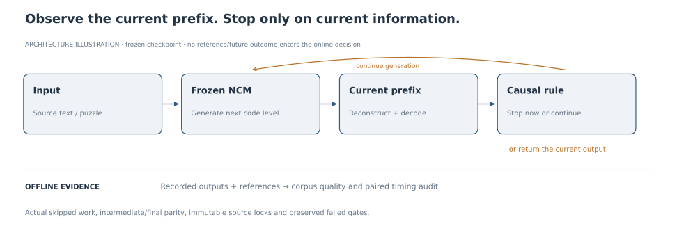
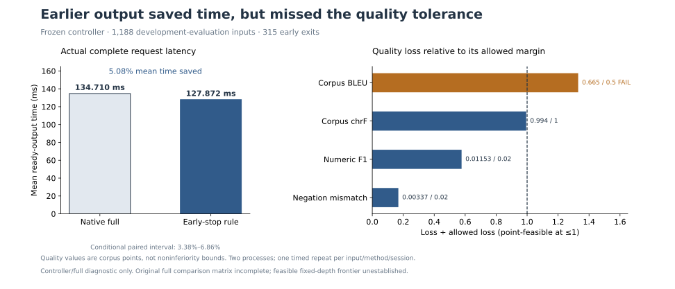
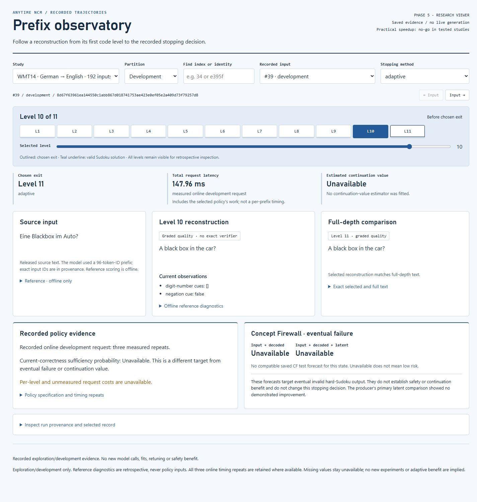

<h1 align="center"> Anytime NCM</h1>

<p align="center"><strong>Adaptive Stopping for Coarse-to-Fine Generation</strong></p>

<p align="center">
  <a href="https://github.com/yoonalexander/Anytime-NCM/releases/tag/research-v0.1.0"></a>
  <a href="docs/PROJECT_OUTCOME.md"></a>
  <a href="https://github.com/HazyResearch/ncm"></a>
  <a href="https://github.com/yoonalexander/Anytime-NCM/actions/workflows/snapshot.yml"></a>
  <a href="docs/delivery/INSTALL.md"></a>
  <a href="RIGHTS.md"></a>
</p>

Anytime NCM investigates whether a frozen [Next-Concept Model](https://github.com/HazyResearch/ncm) can **stop at an earlier refinement level**, preserve output quality, and reduce actual execution time. It implements prefix reconstruction, causal stopping rules and paired evaluation for Sudoku and German-to-English translation.

**Research outcome:** the tested policies did not establish the combined quality-and-latency advantage. The final translation controller saved **5.08% mean time**, but its **0.665 corpus BLEU loss exceeded the 0.5 tolerance**. The studies are closed, with their negative and incomplete findings preserved.

<p align="center">
  
</p>
<p align="center"><em>Architecture illustration. Online decisions use current and past information; references and future outputs belong to offline evaluation.</em></p>

## Highlights

### Reconstruct coarse-to-fine outputs

The adapters reconstruct each full-resolution cumulative prefix using the released learned transformations. Intermediate/final parity, suffix isolation and unchanged model states are checked. Sudoku uses exact constraints; translation uses corpus quality metrics and literal number/negation cues.

### Measure the cost of stopping

The online hook can skip later generation levels. Ready-output latency includes observation, reconstruction, decoding, transfers, features, decisions and synchronization. The final development controller reduced mean latency from **134.710 ms to 127.872 ms**, while missing its BLEU quality limit.

<p align="center">
  
</p>
<p align="center"><em>Saved aggregate evidence, not a new experiment. Timing uncertainty is conditional on the observed sessions; quality values are point estimates.</em></p>

### Inspect the evidence

The portable viewer contains **2,992 historical trajectories** and matching saved Concept Firewall forecasts. Browse refinement levels and recorded decisions without loading a model.

<p align="center">
  
</p>
<p align="center"><em>Historical Phase 5 interface screenshot. The viewer does not contain the later controller campaign or generate new forecasts.</em></p>

## Results

The final development evaluation covered **1,188 inputs**, 60 document/alias components, 315 early exits and 289 numeric-covered references. The rule and comparator were frozen before evaluation. Timing used two processes and one repeat per input/method/session, with 4,772 requests including warmups.

| Endpoint | Observed | Preset requirement | Outcome |
| --- | ---: | ---: | --- |
| Actual mean ready-output time |127.872 ms vs 134.710 ms full|At least 5% mean saving; paired lower bound above zero|5.076% saving; timing screen passes|
| Conditional paired saving interval |[3.377%, 6.861%]|Lower bound above zero|Conditional on sessions and component assumptions|
| Corpus BLEU loss |0.664892|At most 0.5|**Point screen fails**|
| Corpus chrF loss |0.994323|At most 1.0|Point passes; no noninferiority bound|
| Numeric-reference mean F1 loss |0.011534|At most 0.02|Point passes; reference-defined denominator|
| Negation-mismatch increase |0.003367|At most 0.02|Point passes; literal cue diagnostic|

The original twelve-method/two-repeat matrix was interrupted by a reporting failure. A separately frozen controller/full diagnostic produced the timing above; fixed depths 1-10 were not timed in that smaller diagnostic, and the matched-quality fixed-depth frontier remains unestablished. The controller's p95 was slightly worse. Independent quality confirmation was not established, Q0 remains failed, and reserved outcomes remain sealed. See the [final campaign report](docs/studies/quality-tolerant/campaign-20261029-final-report.md) and [timing evidence](results/quality_tolerant/campaign_20261029/first_timing_diagnostic/analysis.json).

Earlier results remain part of the record:

| Study | Finding | Interpretation |
| --- | --- | --- |
| Sudoku prefix audits and online policies |No early exact solutions in the audited settings; no practical adaptive savings|Bounded checkpoint/task findings|
| E2 exact-final-text diagnostic |43/256 early exact matches; charged every-level execution was 13.41% slower than full|Clairvoyant diagnostic, not a deployed selector|
| Post-E2 terminal-only assembly |2.67% estimated savings, below the 5% target|Post hoc assembly of measured cells, not an online benchmark|

[Final outcome](docs/PROJECT_OUTCOME.md) · [E2 report](results/evidence_gaps/e2/summary.md) · [Current roadmap](ROADMAP.md) · [Preserved original roadmap](docs/history/pre-delivery-03e3e70/ROADMAP.md)

## Released artifacts

The [research-v0.1.0 release](https://github.com/yoonalexander/Anytime-NCM/releases/tag/research-v0.1.0) provides a runnable research snapshot. It does not release a translation service or new model weights.

| Artifact | Download | Use |
| --- | --- | --- |
| Python inspector |[Wheel](https://github.com/yoonalexander/Anytime-NCM/releases/download/research-v0.1.0/anytime_ncm-0.1.0-py3-none-any.whl) · [Source](https://github.com/yoonalexander/Anytime-NCM/releases/download/research-v0.1.0/anytime_ncm-0.1.0.tar.gz)|Read source-linked aggregate findings offline|
| Historical viewer |[Standalone HTML](https://github.com/yoonalexander/Anytime-NCM/releases/download/research-v0.1.0/anytime-ncm-legacy-viewer.html)|Browse saved Phase 1-5 trajectories in a browser|
| Research bundle |[ZIP](https://github.com/yoonalexander/Anytime-NCM/releases/download/research-v0.1.0/anytime-ncm-research-0.1.0.zip)|Review selected reports, figures, case study and provenance|
| Verification |[Record](https://github.com/yoonalexander/Anytime-NCM/releases/download/research-v0.1.0/release-verification.json) · [SHA256SUMS](https://github.com/yoonalexander/Anytime-NCM/releases/download/research-v0.1.0/SHA256SUMS)|Check the released artifacts and their exact bytes|

## Installation

Download the wheel above, then install it in a clean environment. The inspector requires **Python 3.10+**, has **zero runtime dependencies**, and needs no model, dataset or GPU.

```bash
# Linux / macOS
python -m venv .venv
.venv/bin/python -m pip install --no-deps ./anytime_ncm-0.1.0-py3-none-any.whl
.venv/bin/python -m anytime_ncm status
```

```powershell
# Windows
python -m venv .venv
.venv\Scripts\python.exe -m pip install --no-deps .\anytime_ncm-0.1.0-py3-none-any.whl
.venv\Scripts\anytime-ncm.exe status
```

For source installation, checksums and the historical research environment, see the [installation guide](docs/delivery/INSTALL.md). Models, corpora and local caches are excluded from the release; nothing is published to a package registry.

## Usage

### Inspect the research snapshot

```bash
python -m anytime_ncm --version
python -m anytime_ncm status
python -m anytime_ncm status --json
```

```python
from anytime_ncm.snapshot import load_snapshot

snapshot = load_snapshot()
print(snapshot["outcome"])
print(snapshot["latest_evaluation"]["quality_point_screen_passed"])  # False
```

### Browse recorded trajectories

Open the downloaded `anytime-ncm-legacy-viewer.html` directly in a browser. From a repository clone, you can also serve the retained HTML:

```bash
python scripts/view_trajectories.py serve --port 8765
```

Open http://127.0.0.1:8765/. This serves saved evidence only. Historical `collect` and `validate-trajectories` commands require the pinned research checkout and dependencies; they are separate from the offline inspector.

## Verification

The released code passed **831 software tests**, **48 native clean-install checks**, and **six Windows/Linux CI jobs** across Python 3.10/3.12/3.14. All six public release downloads were matched to their SHA-256 checksums. These are engineering checks, separate from scientific success. See the [delivery receipt](docs/delivery/COMPLETION.md) for the exact runs and limitations.

```bash
python scripts/audit_retained_evidence.py
# Original machine only: also verify authorized private-cache digests.
python scripts/audit_retained_evidence.py --private
```

Original protocols, source locks, failed gates and accounting ledgers remain intact. Refreshed metadata resolves against [archived original bytes](docs/history/pre-delivery-03e3e70/manifest.json); strict historical verifiers apply to their frozen checkout. [Artifact audit details](docs/delivery/ARTIFACT_AUDIT.md).

## Repository layout

- `src/anytime_ncm/`: reconstruction adapters, causal policies, validators and snapshot inspector
- `scripts/`: research entry points, saved-evidence audits and delivery verification
- `configs/`: frozen research configurations and asset manifests
- `results/`: measurements, decisions, source snapshots and verification receipts
- `docs/studies/`: prospective protocols and scoped reports
- `docs/portfolio/`: [case study](docs/portfolio/CASE_STUDY.md), [website copy](docs/portfolio/WEBSITE_COPY.md) and [curated assets](docs/portfolio/ASSETS.md)
- `docs/assets/`: original architecture illustration, header mark and sourced results figures
- `paper/`: historical manuscript drafts and claim/evidence maps
- `third_party/ncm/`: pinned, unmodified upstream submodule

## Acknowledgements

Built on [Next-Concept Modeling by HazyResearch](https://github.com/HazyResearch/ncm), pinned at `c70274273f489abc73832b2b98584a8483b6b203`. The original work provides the released tokenizer and next-concept generator; this repository investigates adaptive stopping around those frozen models.

Substantial AI assistance is disclosed. Same-assistant verification is not independent human scientific review. Historical manuscripts retain their authorship, rights and review limitations; no journal publication or institutional endorsement is claimed.

The upstream MIT notice is preserved. Original project material has no asserted blanket repository-wide license; see [RIGHTS.md](RIGHTS.md) and [NOTICE.md](NOTICE.md).
