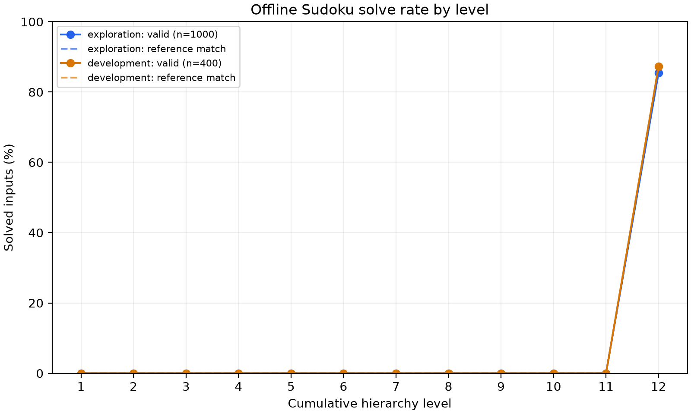
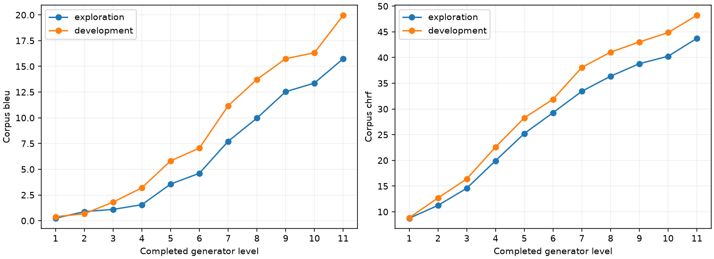

# Adaptive Stopping in Frozen Next-Concept Models: Audits and Negative Results on Sudoku and WMT14

**Anytime NCM project — technical report, draft v2.0**

**Updated:** October 23, 2026 (America/Toronto)

**Empirical snapshot:** repository commit 597d4e741022e88308d003fc39cfe603bf9ac5f9; original execution versions remain in each study's source snapshots and receipts.

**Status:** Research engineering report; not peer reviewed. This revision consolidates saved evidence through Phase 5 and introduces no new inference, fitting, policy selection or experiment.

Version 1 covered only the initial hard-Sudoku audit; its [unchanged manuscript remains in Git history](https://github.com/yoonalexander/Anytime-NCM/blob/597d4e741022e88308d003fc39cfe603bf9ac5f9/RESEARCH_PAPER.md). The original protocols, empirical artifacts and milestone completion receipts retain their historical scope. [README](README.md), [execution roadmap](ROADMAP.md), [conditional next steps](NEXT_STEPS.md).

## Abstract

We investigate whether per-input stopping can improve output quality versus actual latency for frozen Next-Concept Modeling checkpoints. A full-resolution audit of 1,400 hard-Sudoku trajectories finds no complete, valid, clue-preserving solution before the final hierarchy level. Follow-up reference-encoding and easy/medium checkpoint screens also find no early valid solutions at their declared budgets. An extended easy-Sudoku audit again has zero early valid outputs on 1,400 exploration/development inputs. Subsequent explicitly requested online experiments evaluate verified and learned stopping despite those negative opportunity gates. On separate 300-input final subsets, the selected verifier is 0.85% slower than full depth and the primary learned controller is 2.98% slower, with no early exits and identical 299/300 solve counts across their respective methods. A WMT14 German-to-English study evaluates four frozen methods on 256 assigned final inputs: all produce identical outputs at 22.687 BLEU and 50.105 chrF, while guarded stability is 1.95% slower than full depth. Each primary practical-speedup gate fails. A trajectory viewer and exact saved-forecast Concept Firewall bridge make the evidence inspectable but establish no additional predictive or safety benefit. These completed negative studies concern particular checkpoints, policies, allocations and hardware. They do not establish that adaptive generation is universally ineffective; a continuation-value controller, XSum and live risk-driven interventions remain untested.

**Keywords:** adaptive inference; early exit; coarse-to-fine generation; residual vector quantization; Sudoku; machine translation; negative results; reproducibility.

## 1. Research question and contribution

The intended capability is to stop different inputs at different hierarchy levels while retaining acceptable quality and improving total request latency relative to full depth and a strong fixed-depth comparator. A coarse-to-fine hierarchy supplies candidate representations; useful early outputs and economical recognition must still be demonstrated.

NCM generates parallel code positions within successive hierarchy levels and reconstructs outputs from cumulative representations. Its tokenizer uses nested dropout; its paper explicitly identifies input-dependent schedules as future work. These properties motivate an opportunity audit, not an assumption of speedup. [NCM paper, Sections 3 and Appendix I](https://arxiv.org/html/2610.14162v1). Adaptive computation is established: [DeeBERT](https://arxiv.org/abs/2004.12993) permits early layer exits, and [PonderNet](https://arxiv.org/abs/2107.05407) learns computation allocation. Their experiments are context, not numerical baselines for these frozen NCM tasks.

The contribution is an auditable prefix decoder, independent correctness checks, controlled follow-up studies, an actual stopping hook, measured policy comparisons and an inspection interface. No new foundation model, general-purpose safety mechanism or universal impossibility theorem is claimed.

| Original research aim | Evidence at this snapshot |
| --- | --- |
| Find early exact Sudoku solutions | None observed in the audited hard/easy trajectories or bounded medium screen |
| Improve quality–latency versus full and fixed depth | No primary comparison passes its predeclared practical-speedup/frontier gates |
| Establish useful incremental internal signals | The tested discrete-code-statistic ablation does not improve deployed current-validity prediction |
| Assess language generalization | WMT14 is evaluated; XSum is not |
| Inspect trajectories and failure-risk signals | Viewer and saved-evidence bridge complete; no live joint policy or safety benefit validated |

Completing a scoped phase means its implementation, finite allocation, validation and report are delivered. It does not mean its scientific hypothesis succeeded or that every broader idea in the original design was tested.

## 2. Artifacts, reconstruction and evaluation design

### 2.1. Frozen checkpoints and task-specific semantics

| Component | Identifier or recorded condition |
| --- | --- |
| Upstream NCM source | c70274273f489abc73832b2b98584a8483b6b203 |
| Checkpoint repository / revision | hazyresearch/ncm-checkpoints / d342ce8aaea58830eef3b8ad473664673e41f692 |
| Dataset repository / revision | hazyresearch/ncm-datasets / 6580ba41a4b0a976dde876fbe84d25327617b0e6 |
| GPU experiment pathway | RTX 5060, WSL2 Ubuntu 24.04, Torch 2.10.0+cu128, CUDA runtime 12.8 |
| Execution | Float32/eval, four CPU threads, no autocast/compilation/KV-cache optimization |
| Online request benchmark | Batch 1; unchanged task-specific released sampling |

Full file hashes and per-stage environments are retained in [setup sources](configs/setup_sources.json), [WMT sources](configs/phase4_wmt_sources.json), and linked execution receipts. Pretrained generator/tokenizer weights remain unchanged. Phase 3 fits six small logistic controllers on CPU; that is distinct from training the NCM checkpoint. The Concept Firewall producer is a separate recorded run with its own environment.

| Task | Generator levels | Per-level code lengths | Total generated code positions | Source / decoded target contract |
| --- | ---: | --- | ---: | --- |
| Sudoku | 12 | 1, 2, 4, 6, 9, 13, 18, 26, 37, 50, 67, 89 | 322 | 91 input IDs; 89 decoded IDs including eight separators; 81 board cells |
| WMT14 De-En | 11 | 1, 4, 8, 14, 20, 26, 32, 40, 48, 56, 64 | 313 | 96-ID source prefix; 64 decoded target IDs before official EOS/special-token handling |

The last level's width is not the total amount of generated code. Skipped levels/code positions are work counts, not measured latency or FLOPs.

For Sudoku, each cumulative code prefix is reconstructed at the tokenizer's full resolution in the pinned embedding/upsampling/residual order. Tests exercise nonidentity transforms, storage independence and isolation from future code suffixes. A fresh official comparison matches all 32 initial exploration cases at final output. [Partial-decoding contract](docs/phase1b_partial_decoding.md).

WMT uses a different learned cascade, including intermediate GroupNorm, residual transforms and a generator that predicts level zero. All 192 audited trajectories pass independent full-resolution reconstruction checks; 32 matched batch-one official/disabled-hook requests have exact codes, token IDs and text parity. The Qwen3-0.6B tokenizer is pinned at c1899de289a04d12100db370d81485cdf75e47ca; no Qwen language-model weights are used. [WMT protocol](docs/studies/phase4-wmt14-protocol.md).

The upstream checkout remains unchanged. Online experiments use an isolated generation hook; parity/forced-stop tests show that the hook can actually omit later generator evaluations. Offline trajectory collection runs every level and therefore saves no generation work.

### 2.2. Partitions, chronology and access

The original 2,000 hard-Sudoku identities were allocated before inference: 1,000 exploration, 400 development, 300 phase2_final and 300 phase3_final. R1A uses exploration only; R1B uses the first 32 preselected exploration references. R2 screens 32 easy and 32 medium inputs. R3's easy audit reuses its 32 screened examples within 1,000 exploration identities, plus 400 development identities.

The later easy-Sudoku online studies use their corresponding Phase 2/3 reserved allocations. Shared solution identities and cross-difficulty row reservations are disclosed in the [R2 report](results/followup/sudoku_checkpoint_screen/summary.md) and subsequent protocols; they are not independent fresh datasets. All phase-specific final subsets have now been evaluated. The original reservation descriptions remain historical records, not current unused-test claims.

WMT's input-only manifest groups by effective truncated/padded source IDs. All 3,003 released groups are distinct: 512 exploration, 256 development, 256 final and 1,979 reserved. The audit uses 128 exploration and 64 development groups; final evaluation uses all 256 assigned final groups. The remaining groups/unused audit rows are not an authorization to collect more results.

Official full-set baselines internally score final examples before policy studies, with aggregate-only analyst inspection. Training overlap is unknown. These are reserved policy-evaluation subsets with disclosed prior exposure, not untouched official tests or contamination guarantees.

Each later study has a separate protocol and budget. R2 remains negative after R3; the original no-go is not retroactively changed by the user's subsequent entry exceptions for R3, Phase 2 or Phase 3. Online policy locks were committed/pushed and released before their final per-input access: [Phase 2](results/phase2/policy_lock_release.json), [Phase 3](results/phase3/policy_lock_release.json), [WMT](results/phase4/wmt14/policy_lock_release.json). No final-driven retuning or favorable-result budget expansion is claimed.

### 2.3. Quality and claim rules

Sudoku primary acceptance requires a parseable, complete grid satisfying every row/column/box constraint and preserving supplied clues. Equality to a reference is diagnostic. Official solved/cell/valid-grid metrics remain separate; their prefix-length behavior cannot substitute for independent acceptance.

The online Sudoku gate requires at least 5% mean ready-output wall-time reduction with a positive lower paired 95% bound, zero empirical solve loss, zero invalid early accepts and passed correctness/parity checks. A frontier claim must also beat the development-selected fixed-depth comparator at matched quality. Zero observed errors do not guarantee population correctness.

WMT uses cased corpus BLEU and corpus chrF with pinned sacreBLEU 2.6.0 defaults. Loss tolerances are 0.5 BLEU and 1.0 chrF point on 0–100 scales. The final claim requires the quality-difference lower bounds to remain within both margins, at least 5% mean latency reduction with lower bound above zero, and declared literal-cue guardrails. Number-reference F1 loss and negation-cue mismatch increases are limited to 0.02 at development feasibility selection, where defined. BLEU/chrF and these heuristics do not establish factual correctness.

### 2.4. Costs and uncertainty

Phase 1/R3 diagnostic cost models sum measured generation/reconstruction/decoding/transfer/checking components. They include instrumentation and are estimates of a hypothetical schedule; they are not measured interleaved online latency. Calibration sensitivity is retained separately.

Phases 2–4 measure synchronized warm batch-one ready-output wall time. Input preparation, generation, reconstruction, decoding, transfers, text, features and policy/verifier work actually used are included. Loading, warmups, offline reference scoring, diagnostic code transfer and serialization are excluded. Method order rotates by identity and repetition. CUDA events are secondary stream-elapsed clocks including host gaps, not kernel-busy time; peak allocated memory is not total device memory, and reciprocal serial latency is not batched throughput.

Each online final comparison retains three repetitions per identity/method. Paired bootstrap resampling uses 10,000 identity resamples, keeping repetitions together. Sudoku online seed is 20261022; WMT seed is 20261023. WMT quality uses repeat zero after deterministic-output checks and exact corpus sufficient-statistic resampling, not averaged sentence BLEU. Intervals are conditional on the recorded allocation/process; news-document IDs and independent process replications are unavailable.

For tables below, **overhead = 100 × (mean method time / mean full-depth time − 1)**. Positive overhead means slower. Its interval is the sign-reversed reported latency-reduction interval. Cross-phase absolute times belong to different runs/allocations and must not be interpreted as a longitudinal optimization result.

## 3. Initial hard-Sudoku audit and follow-up diagnosis

### 3.1. Phase 0–1: operational baseline and early-output opportunity

The unchanged official evaluator solves 1,725/2,000 hard-Sudoku examples (86.25%) at the recorded batch 128. The original paper reports 86.1% in [Table 3](https://arxiv.org/html/2610.14162v1#S4.SS4). The 0.15-percentage-point difference remains unexplained. These released reference-based baseline scores have not been independently rescored with the later checker; no exact paper-number or all-input parity claim is made.

| Hard-Sudoku audit partition | Inputs | Valid before level 12 | Valid at level 12 | Never valid |
| --- | ---: | ---: | ---: | ---: |
| Exploration | 1,000 | 0 | 854 | 146 |
| Development | 400 | 0 | 349 | 51 |

All 1,400 trajectories contribute 12 levels, for 16,800 states. Cell accuracy improves without producing an earlier complete, clue-preserving valid board. Offline first-valid stopping consequently skips no generation on these trajectories.

Diagnostic profiling covers 200 identities × five repetitions, plus ten warmups. On the 100-identity development profile, estimated full-depth time is 151.021 ms and every-level checking is 217.735 ms: **44.18% estimated overhead**, paired 95% interval **[43.45%,45.02%]**. The calibration-sensitivity calculation is also no-go. The independently profiled batch-one outputs determine that comparison; intermediate collection/profiling outputs are not assumed identical across batch sizes.

[Analysis](results/phase1/analysis.json), [profile metadata](results/phase1/profiles/run.json), [Phase 1 report](results/phase1/summary.md). This completed negative opportunity/cost audit is not a measured online slowdown; those measurements occur in Section 4.

### 3.2. R1A–R3: bounded follow-ups

| Study | Scope | Recorded finding |
| --- | --- | --- |
| R1A: saved-prefix error diagnosis | 1,000 hard exploration inputs; no new inference | At level 11, 999/1,000 violate a supplied clue; mean wrong reference cells 14.821, including 4.964 at given clues |
| R1B: target-encoded prefix pilot | First 32 preselected hard exploration references; 32 encodings /384 decodes | All 32 final target reconstructions round-trip exactly; neither target-encoded nor cached generated paths produces an early valid board; cached generated final validity is 24/32 |
| R2: easy/medium checkpoint screens | 32 audited inputs per candidate | Zero early valid outputs for either; final validity 32/32 easy and 31/32 medium; 32/32 matched official token/text parity for each |
| R3: extended easy audit | 1,000 exploration, including 32 reused R2 cases, plus 400 development | Zero early valid outputs; final validity 994/1,000 exploration and 396/400 development |

R1A describes errors rather than identifying a causal mechanism. At the hard final level every audited exploration output preserves clues and contains no blanks, yet 146 remain invalid; those conditions alone do not establish solution validity. R1B shows that the tested target-code prefixes also fail exact early reconstruction, while final reference round trips work. It does not rule out every alternative code sequence, tokenizer or decoder.

R3's development component model estimates 104.224 ms full depth versus 145.198 ms with every-level checking: **39.31% estimated overhead**, paired interval **[38.96%,39.68%]**. Sensitivity analysis remains negative. The subsequent online studies use distinct measurement boundaries and cannot be substituted for this diagnostic estimate.

These studies are sequential and partly overlapping; their sample counts must not be pooled as independent replications. [R1A](results/followup/sudoku_prefix_diagnosis/summary.md), [R1B](results/followup/sudoku_target_encoding/summary.md), [R2](results/followup/sudoku_checkpoint_screen/summary.md), [R3](results/followup/sudoku_easy_r3/summary.md).

## 4. Phase 2: measured online verified stopping

Phase 2 was explicitly requested despite the failed opportunity gate. Its separately frozen entry exception does not convert the earlier result to go. The implementation includes 192 real parity/forced-stop requests, a seven-method development comparison with 2,100 timed requests, and a five-method final comparison with 4,500 timed requests on 300 assigned final identities. Warmups are separate.

The development-selected verifier inspects only level 12. That selected schedule has no possible early-generation savings. A stability comparator and every-level exact checking are retained; fixed depth is selected before final outcomes.

| Method | Valid unique inputs | Mean ms | Median ms | p95 ms | Overhead vs full / paired 95% interval | Early timed requests |
| --- | --- | ---: | ---: | ---: | --- | ---: |
| fixed | 299/300 | 100.921 | 100.394 | 110.750 | -0.06% / [-0.53%, 0.40%] | 0 |
| full | 299/300 | 100.978 | 100.563 | 111.442 | 0.00% / [0.00%, 0.00%] | 0 |
| stability | 299/300 | 103.482 | 102.956 | 114.539 | 2.48% / [2.01%, 2.95%] | 0 |
| verified_all | 299/300 | 116.033 | 115.669 | 128.629 | 14.91% / [14.38%, 15.47%] | 0 |
| verified_selected | 299/300 | 101.836 | 101.205 | 112.780 | 0.85% / [0.39%, 1.34%] | 0 |

Every method solves 299/300 unique final inputs, with zero early requests and zero invalid early accepts. These equal solve counts do not establish a population correctness guarantee. Full depth averages 100.978 ms; the selected verifier averages 101.836 ms, **0.85% slower**, paired overhead interval **[0.39%,1.34%]**. Every-level verification costs 14.91% more than full depth.

The selected verifier is also slower than the development-selected fixed comparator; both practical-speedup and adaptive-frontier gates fail. The hook is capable of true skipping under forced controls, but these data/policies supply no empirical early exit. [Final analysis](results/phase2/analysis.json), [frozen protocol](docs/studies/phase2-easy-online-protocol.md), [report](results/phase2/summary.md).

## 5. Phase 3: learned current-validity stopping

### 5.1. Target, features and selection

Six standardized logistic regressions are fitted using 1,000 easy exploration trajectories /12,000 level states. Their target is **current solution validity**, not expected quality gain from continuing. There are zero positive pre-final exploration/development labels; all training positives occur at the final level.

The base family uses level/code counts, input clue density, decoded token histograms and changes from the previous inspected output. Internal adds current discrete-code histograms, entropy/concentration/distinctness and adjacent changes. Models exclude exact clue/unit validity flags, references, solutions, future outputs and sample identity. This is a limited code-statistic ablation, not an exhaustive hidden-state/logit study.

Exploration supplies fitting/normalization; all 400 development trajectories select regularization and stopping parameters. Selected C is 10 for base and 0.1 for internal; both inspect from level 10 with threshold 0.5. Policy fitting uses consecutive observations, while the deployed tracker's history begins at its selected inspection level; schedule-specific selection/calibration reflects that distinction.

The seven-method development benchmark has 2,100 timed requests. After the committed/pushed lock is released, seven frozen methods run on 300 separate assigned final identities × three repetitions, for 6,300 final timed requests. The pretrained generator/tokenizer are unchanged. [Training record](results/phase3/training.json), [protocol](docs/studies/phase3-easy-learned-protocol.md).

### 5.2. Final comparison and ablation

| Method | Valid unique inputs | Mean ms | Median ms | p95 ms | Overhead vs full / paired 95% interval | Early timed requests |
| --- | --- | ---: | ---: | ---: | --- | ---: |
| fixed | 299/300 | 99.090 | 98.302 | 109.819 | 0.24% / [-0.25%, 0.76%] | 0 |
| full | 299/300 | 98.850 | 98.310 | 108.834 | 0.00% / [0.00%, 0.00%] | 0 |
| learned_base | 299/300 | 102.170 | 101.160 | 112.341 | 3.36% / [2.77%, 3.97%] | 0 |
| learned_internal | 299/300 | 101.800 | 101.047 | 112.608 | 2.98% / [2.54%, 3.44%] | 0 |
| stability | 299/300 | 102.129 | 101.408 | 112.085 | 3.32% / [2.82%, 3.84%] | 0 |
| verified_all | 299/300 | 113.614 | 113.143 | 125.368 | 14.94% / [14.38%, 15.51%] | 0 |
| verified_selected | 299/300 | 100.059 | 99.338 | 110.686 | 1.22% / [0.77%, 1.68%] | 0 |

All seven methods solve 299/300 inputs, with zero early requests and zero invalid early accepts. The primary internal model averages 101.800 ms versus 98.850 ms full depth: **2.98% overhead**, paired interval **[2.54%,3.44%]**. It is 2.73% slower than the selected fixed-depth comparator. Both practical/frontier gates fail.

On matched inspected states, internal-minus-base Brier difference is **0.000318**, paired interval **[0.000177,0.000415]**; positive values favor base. The added code statistics worsen this descriptive comparison. That result does not establish absence of useful information in every internal representation.

Calibration uses repeat zero at the actually inspected levels; latency retains all repetitions. The predeclared <=27-clue subgroup has zero final examples, so its comparison is unavailable. [Final analysis](results/phase3/analysis.json), [report](results/phase3/summary.md).

## 6. Phase 4: WMT14 German-to-English generalization

### 6.1. Task baseline and intermediate quality

The released WMT checkpoint is evaluated on all 3,003 official rows using verbatim pinned evaluator function bodies. The predeclared batch-size override is 8 rather than the release default 64 for memory headroom. The operational baseline scores **21.722 BLEU /49.570 chrF**, with lowercase BLEU 22.615. Exact default-batch or paper-number parity is not claimed.

The recorded baseline process clock covers its batch loop and scoring after model/data loading; separate load time was not recorded. It is not warm request latency. Exactly 24 sources exceed the released 96-ID prefix cap. Sampling remains temperature 1, top-k 1, top-p 0 and guidance 0; batch-one benchmark seeds are reset outside the timed request. [Pinned source inventory](configs/phase4_wmt_sources.json), [baseline](results/phase4/wmt14/official_full.json).

The audit contains 128 exploration and 64 development full-resolution trajectories. Development corpus quality rises from 0.387 BLEU /8.846 chrF at level 1 to 19.966 BLEU /48.220 chrF at level 11. Nevertheless, **147/640 adjacent development transitions lower sentence chrF**. These are offline reference-metric deteriorations, not established factual damage or deployed acceptance labels.

### 6.2. Frozen policy family

All 11 fixed depths and 36 adaptive candidates are retained. Stability/guarded stability use minimum inspection level in {5,8,10}, patience in {1,2}, and token-change threshold in {0,0.02,0.05}. Guarded stability additionally requires unchanged literal number/negation cues. The first observation cannot stop; level 11 is unconditional fallback.

Development feasibility uses the declared quality/cue margins. Selection first minimizes mean inspected decodes, then generated levels, with frozen tie breaks. This is an inspection-count proxy, not exhaustive measured-latency optimization. The 768 timed development requests do not expand or retune the family.

The selected fixed depth is 11. Both selected adaptive rules have minimum 10, patience 1 and threshold 0. Their first inspection is level 10 and their next is the final fallback, so **these selected rules necessarily run to full depth**. They demonstrate no early-generation headroom.

### 6.3. Final comparison

Four frozen methods run on 256 assigned final identities × three repetitions: 3,072 timed requests, plus 32 exploration warmups.

| Method | BLEU / chrF | Mean ms | Median ms | p95 ms | Overhead vs full / paired 95% interval | Early timed requests |
| --- | --- | ---: | ---: | ---: | --- | ---: |
| adaptive | 22.687 / 50.105 | 137.529 | 136.239 | 151.629 | 1.95% / [1.40%, 2.49%] | 0 |
| fixed | 22.687 / 50.105 | 134.656 | 133.535 | 148.493 | -0.18% / [-0.65%, 0.28%] | 0 |
| full | 22.687 / 50.105 | 134.905 | 133.661 | 150.501 | 0.00% / [0.00%, 0.00%] | 0 |
| stability | 22.687 / 50.105 | 137.247 | 136.359 | 151.772 | 1.74% / [1.26%, 2.20%] | 0 |

All methods produce identical outputs, **22.687 BLEU /50.105 chrF**, with zero early requests. The quality differences and paired quality intervals versus full depth are exactly zero for these observed outputs. Guarded stability averages 137.529 ms versus 134.905 ms full depth: **1.95% overhead**, paired interval **[1.40%,2.49%]**. It is 2.13% slower than selected fixed depth, with overhead interval **[1.63%,2.63%]**. Both claim gates fail.

The full official baseline and this 256-input comparison use different subsets and batch conditions; their different BLEU/chrF values are not evidence of a checkpoint improvement. Identical observed output quality also does not establish semantic equivalence to references or factual safety. [Analysis](results/phase4/wmt14/analysis.json), [protocol](docs/studies/phase4-wmt14-protocol.md), [report](results/phase4/wmt14/summary.md).

## 7. Phase 5: inspection interface and saved failure-risk bridge

The self-contained viewer covers **2,992 audited exploration/development trajectories /35,712 levels**: 1,400 hard Sudoku, 1,400 easy Sudoku and 192 WMT inputs. It exposes source, per-level reconstruction, current issues, offline diagnostics, chosen exit, full-depth output, actual policy traces, recorded timing repetitions and provenance. Unmeasured request latency and unfitted continuation values remain unavailable.

The bridge consumes the actual Concept Firewall version-1 saved-forecast interface. It verifies upstream/checkpoint hashes, converts Anytime's token-list puzzle identity to CF's canonical 81-digit identity, then requires exact current level, cumulative code groups and decoded board. It attaches **3,468 exact matching states across 289 audited hard-Sudoku puzzles**; zero mismatches receive a forecast. Easy Sudoku, WMT and unmatched states remain unavailable. Level 12 is post-generation diagnosis.

These are the producer's existing internal-test input_decoded and input_decoded_latent forecasts of **eventual hard-Sudoku invalidity**. No new probe predictions, joint stopping policy or intervention is produced. The producer's reported primary latent AUROC increment remains -0.0078, paired interval [-0.0368,+0.0193]. It is not a new Anytime experiment. Cross-batch bitwise latent/numeric probe parity is not claimed.

This phase validates correspondence and display fidelity, not predictive gain, speedup or safety. [Viewer](results/phase5/viewer.html), [actual integration contract](docs/phase5_firewall_contract.md), [forecast export and source digests](results/phase5/firewall_bridge.json), [completion report](results/phase5/summary.md).

## 8. Interpretation

### 8.1. Finished work and unsuccessful hypotheses

The finite experiments and tools are complete within their recorded scopes. Their results do not demonstrate the intended quality–latency advantage. No audited early Sudoku board satisfies exact acceptance, so the studied first-valid policy has no generation work to avoid. A controller choosing among unchanged decoded prefixes cannot create an absent valid board.

Translation has graded and non-monotonic reference quality rather than an exact acceptance predicate. The tested candidate family selects full-depth fallbacks; that negative outcome does not exclude every alternative signal or useful early exit. It also does not establish that a learned expected-benefit policy would work.

The online studies were undertaken through explicit entry exceptions after negative opportunity evidence. They provide measured comparisons and validate engineering, but are not confirmations of a previously positive early-output hypothesis. Passing 433 software tests establishes the tested implementation properties, not scientific success.

### 8.2. Different prediction targets

Three quantities must remain separate:

1. **Current sufficiency:** whether the presently decoded answer satisfies the chosen quality target. Phase 3 learns current Sudoku validity.
2. **Eventual failure:** whether the final answer will fail. Phase 5 displays existing CF forecasts of this different target.
3. **Continuation value:** expected quality benefit from additional refinement relative to its incremental cost. No such estimator was fitted.

A probability of current correctness or final failure is not automatically a continuation value. Abandoning likely failures, repairing decoded boards, changing the hierarchy or modifying checkpoint training would require a different objective, risk/quality contract and evaluation.

### 8.3. Limits of the negative conclusion

The evidence supports no practical-speedup/frontier claim for the reported methods under the tested conditions. It does not prove all frozen NCM checkpoints incapable of adaptive inference. XSum, different decoders/checkpoints, broader internal signals, constrained repair, stochastic schedules, prefix-aware retraining and live CF-driven stopping are not established by these experiments.

The Phase 3 internal-feature result applies to discrete code statistics on deployed Sudoku inspection states. It is not a test of all transformer activations, all latent representations or cross-task predictive value. The CF producer's separate negative primary result is retained as provenance, not substituted for an Anytime safety experiment.

## 9. Limitations and threats to validity

- **Finite settings and related data.** Audits/screens differ in scope and partly reuse identities. Repetitions are timing observations, not new independent puzzles. Both Sudoku final allocations and WMT's assigned final subset are consumed; later reuse cannot be described as fresh confirmation.
- **Prior exposure.** Official full baselines scored all released examples internally with aggregate-only analyst inspection. Shared solution identities and unknown training overlap preclude a claim of untouched public tests or contamination-free generalization.
- **Conditional uncertainty.** One GPU/software pathway and fixed allocations/processes are studied. Identity bootstrap intervals do not capture all hardware, instrumentation, corpus-selection or process uncertainty. WMT document-level clusters were unavailable.
- **Cost boundaries.** Component-sum estimates, actual online latency, code counts, CUDA stream time, peak allocation and batched throughput are different quantities. Full and fixed methods may differ slightly in measured time despite identical depth; sub-percent point differences do not satisfy the practical gate.
- **Batch and sampling effects.** Independent batch-one profiles retain their own outputs. Intermediate token differences occur between some hard collection/profile cases. WMT's batch-8 official override and task-specific tokenization/GroupNorm path are disclosed; universal numerical parity is not claimed.
- **Metric scope.** Exact Sudoku validity is task-specific. BLEU/chrF, digit-number sets and literal negation cues do not certify semantic correctness, factuality or safety. Written numbers, punctuation, paraphrases and source/reference discrepancies can create missed/false heuristic flags.
- **Unresolved baseline reproduction.** Hard Sudoku scores 86.25% versus the published 86.1%. No cause is established and no explanation is inferred from precision/environment differences alone. Operational reproduction is complete; exact paper-number agreement remains open.
- **Mechanistic diagnosis.** R1B's 32 successful final target round trips with no early valid target prefixes narrow a diagnostic question but do not prove which architecture/training mechanism causes final-level dependence.
- **Unsupported benefits.** No continuation-value controller, XSum experiment, live CF stopping/intervention, online safety effectiveness or positive incremental latent benefit is claimed. The viewer is retrospective; forecasts do not alter decisions.

## 10. Reproducibility, work accounting and documentation history

### 10.1. Evidence index

| Study | Protocol / primary evidence |
| --- | --- |
| Phase 1 hard audit | [Protocol](docs/experiment_protocol.md), [analysis](results/phase1/analysis.json), [trajectories](results/phase1/trajectories.jsonl), [profiles](results/phase1/profiles/run.json) |
| R1A saved diagnosis | [Plan](docs/studies/sudoku-prefix-diagnosis-plan.md), [completion](results/followup/sudoku_prefix_diagnosis/completion.json) |
| R1B target encoding | [Protocol](docs/studies/sudoku-target-encoding-protocol.md), [completion](results/followup/sudoku_target_encoding/completion.json) |
| R2 easy/medium screen | [Protocol](docs/studies/sudoku-checkpoint-screen-protocol.md), [completion](results/followup/sudoku_checkpoint_screen/completion.json) |
| R3 easy extension | [Report](results/followup/sudoku_easy_r3/summary.md), [completion](results/followup/sudoku_easy_r3/completion.json) |
| Phase 2 online | [Protocol](docs/studies/phase2-easy-online-protocol.md), [analysis](results/phase2/analysis.json), [completion](results/phase2/completion.json) |
| Phase 3 learned | [Protocol](docs/studies/phase3-easy-learned-protocol.md), [training](results/phase3/training.json), [analysis](results/phase3/analysis.json), [completion](results/phase3/completion.json) |
| Phase 4 WMT | [Protocol](docs/studies/phase4-wmt14-protocol.md), [sources](configs/phase4_wmt_sources.json), [analysis](results/phase4/wmt14/analysis.json), [completion](results/phase4/wmt14/completion.json) |
| Phase 5 inspection | [Scope](docs/phase5_scope.md), [bridge contract](docs/phase5_firewall_contract.md), [build](results/phase5/build.json), [completion](results/phase5/completion.json) |

This narrative cites existing evidence; it does not replace source snapshots, statistical code, raw records or frozen historical documents. Version-1 statements about then-reserved final sets and then-unimplemented online work describe that earlier snapshot; this revision records their subsequent use/completion.

### 10.2. New work allocated to the online/task studies

| Study | NCM input-generations | Sample-weighted generator levels | Decoder forwards | Full encoder forwards |
| --- | ---: | ---: | ---: | ---: |
| Phase 2 | 6,912 | 82,382 | 25,906 | 0 |
| Phase 3 | 8,540 | 102,480 | 29,280 | 0 |
| Phase 4 | 7,163 | 78,793 | 11,035 | 0 |
| Phase 5 | 0 | 0 | 0 | 0 |

These are the respective study allocations, including their declared parity/baseline/warmup work; they are not counts of unique independent examples or totals for all earlier studies. R1B's 32 target encodings, R2/R3 work and initial Phase 1 records have separate ledgers. Prefix embedding lookups still occur even when full encoder-forward count is zero. Source receipts disclose interruptions/amendments and preserve allocated work. Phase 2–4 completion receipts record zero failed model evaluations/retries. Phase 3 includes six lightweight CPU fits.

No new checkpoint inference, fits, policy choices or scientific observations were collected to write this revision.

### 10.3. Verification and available artifacts

The current recorded full suite has **433 passing tests**, with zero failures/errors/skips. Phase 5 contributes 29 viewer tests; milestone counts of 189, 353, 380 and 404 describe earlier snapshots and are not additional independent trials. This documentation-only revision uses that unchanged-code suite and rechecks documentation/source compatibility; it does not claim a newly rerun 433-test experiment.

Saved-data checks can be run without repeating checkpoint inference:

~~~powershell
python scripts/validate_trajectories.py --metadata results/phase1/trajectories.metadata.json
python scripts/verify_phase1d.py
.\scripts\wsl_python.ps1 -PythonArguments @('scripts/run_phase2.py','verify')
.\scripts\wsl_python.ps1 -PythonArguments @('scripts/run_phase3.py','verify')
.\scripts\wsl_python.ps1 -PythonArguments @('scripts/run_phase4.py','verify')
python scripts/view_trajectories.py verify
~~~

The phase verifiers require their pinned local inputs for integrity checks. Heavy checkpoints/datasets remain outside Git. The committed portable viewer embeds its recorded data and needs no ML packages or weights to view; an optional standard-library loopback server is available:

~~~powershell
python scripts/view_trajectories.py serve
~~~

Open http://127.0.0.1:8765/. Browser checks cover the served viewer; direct file-URL navigation was tool-restricted. Source/artifact hashes and [browser evidence](results/phase5/browser_checks.json) are retained.

Do not rerun consumed inference stages to regenerate reports or overwrite historical test artifacts. Completed milestone receipts freeze the documentation/source versions at their own commits; later README/manuscript edits do not invalidate or silently rewrite those historical records. The mutable [current compatibility review](results/phase1/review_validation.json) is archived/refreshed when current documentation changes. [Documentation-revision provenance](docs/research_paper_update_2026-10-23.json) identifies the evidence and checks for this revision.

## 11. Remaining research and conditional next steps

The scoped phases are complete; the intended adaptive-speedup capability remains unachieved. Current-validity learning and a saved-forecast bridge do not complete every broader idea in the original design.

A possible next research step is a **bounded WMT opportunity audit using only existing exploration/development trajectories**: ask whether an optimistic reference-informed assignment of exits can satisfy the declared corpus-quality tolerances while avoiding enough work to plausibly cover monitoring. This proposed audit has not been performed as part of this revision. It must distinguish generated-work savings/estimated costs from measured latency and must not tune on the consumed final subset.

If a meaningful optimistic bound exists, a separately frozen continuation-value study could be justified using suitable fresh evaluation data and an explicit cost budget. If it does not, close this tested frozen-checkpoint line at its declared budget. Changing a checkpoint, training objective or decoder would define a new study, not silently repair a negative historical result. No further experiment is authorized or launched by this documentation update.

## 12. Conclusion

The completed audits find no early exact solutions in the tested Sudoku trajectories, and actual online verified/learned stopping adds overhead without skipping levels in the final comparisons. WMT demonstrates graded, sometimes non-monotonic reference quality, but its selected methods also reach full depth and fail the practical-speedup/frontier gates. The resulting repository provides reproducible negative evidence and working inspection/stopping infrastructure. It establishes neither a successful adaptive-speedup method nor a universal impossibility result. Future progress requires a distinct, justified hypothesis and appropriately scoped evaluation.

## References

[1] Hermann Kumbong et al. 2026. *Next-Concept Modeling: Fast, Parallel Coarse-to-Fine Text Generation*. arXiv:2610.14162v1. [Paper](https://arxiv.org/html/2610.14162v1), [pinned official code](https://github.com/HazyResearch/ncm/tree/c70274273f489abc73832b2b98584a8483b6b203). Background and published baseline comparison; local artifacts support the reported Anytime experiments.

[2] Ji Xin, Raphael Tang, Jaejun Lee, Yaoliang Yu and Jimmy Lin. 2020. *DeeBERT: Dynamic Early Exiting for Accelerating BERT Inference*. ACL 2020; arXiv:2004.12993. [Primary source](https://arxiv.org/abs/2004.12993).

[3] Andrea Banino, Jan Balaguer and Charles Blundell. 2021. *PonderNet: Learning to Ponder*. arXiv:2107.05407v2. [Primary source](https://arxiv.org/abs/2107.05407).

External references above were checked against their primary arXiv pages on October 23, 2026. No numerical result from DeeBERT or PonderNet is used as a performance baseline here.
