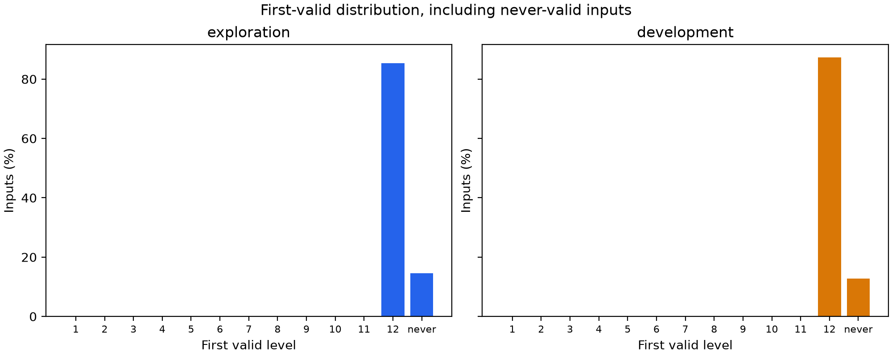
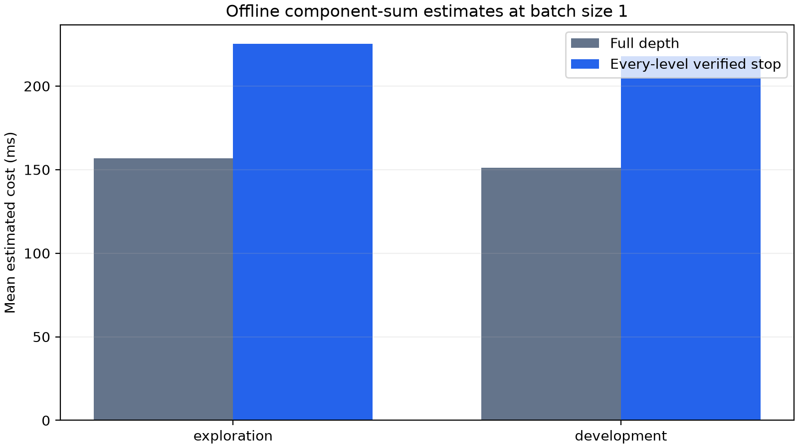

# An Offline Audit of Verified Early Exit in Next-Concept Modeling for Hard Sudoku

**Anytime NCM project — technical report, draft v1.0**

**Date:** October 21, 2026 (America/Toronto)

**Empirical snapshot:** repository commit `a83229c850c4401035fc09dfce015974fd98be4a`; experiments completed October 20, with quality-reporting review on October 21.

**Status:** Research engineering report; not a peer-reviewed publication. This manuscript introduces no new experiments.

**Companion plan:** [Next steps and revised research roadmap](NEXT_STEPS.md).

## Abstract

We investigate whether a frozen Next-Concept Modeling (NCM) checkpoint can support verified early exit on hard Sudoku without reducing empirical solution quality. We implement and validate full-resolution reconstruction of every cumulative latent-code prefix, separate structural correctness from reference agreement, and audit 1,000 exploration and 400 development puzzles under a protocol fixed before output inspection. Across 16,800 intermediate states, no complete, grid-valid, clue-consistent solution appears before the twelfth and final hierarchy level. Final valid-solution rates are 85.40% on exploration and 87.25% on development. Separately, diagnostic profiling covers 200 puzzle identities with five repeats each. On the 100-identity development profile, a component-sum estimate of checking every level costs 217.74 ms per puzzle, compared with 151.02 ms for full generation followed by one final decode. The estimated relative latency reduction is −44.18%, with a paired puzzle-identity bootstrap 95% interval of [−45.02%, −43.45%]. Correctness and parity checks pass, but the predeclared minimum worthwhile improvement of 5% is not met. We therefore close the offline study with a no-go for online first-valid stopping in this setting. The result concerns one checkpoint, task, reconstruction method, and deterministic sampling configuration; it neither measures an online slowdown nor establishes that adaptive computation is ineffective in other settings.

**Keywords:** adaptive inference; early exit; coarse-to-fine generation; residual vector quantization; Sudoku; negative results; reproducibility.

## 1. Introduction

Adaptive inference can reduce computation only when an acceptable answer is available before the default computation finishes, and when recognizing that answer costs less than the work avoided. A hierarchy with progressively richer representations does not, by itself, establish either condition. Exact-output tasks sharpen this distinction: a nearly correct Sudoku grid may contain useful information while still being unusable as a verified solution.

NCM generates a hierarchy of discrete latent codes from coarse to fine, predicting positions within each level in parallel and decoding the cumulative representation into text. Its tokenizer uses nested dropout to encourage informative partial reconstructions [1]. These properties motivate auditing intermediate outputs, but do not guarantee that an earlier prefix solves an exact-constraint task.

This study addresses three questions:

1. **Availability:** Does a complete, valid, clue-preserving solution occur before the last level?
2. **Accounting:** Would avoided generation work outweigh reconstruction, decoding, transfer, and verification overhead under first-valid stopping?
3. **Decision:** Does the evidence justify implementing and benchmarking an actual online stopping mechanism under the predeclared gate?

The study contributes an auditable prefix-reconstruction and correctness implementation, a partition-controlled trajectory dataset, a diagnostic cost model with repeated measurements, and a reproducible negative decision for the tested setting. We make no claim of a new NCM architecture, trained stopping policy, universal impossibility result, or established publication novelty.

## 2. Context and scope

Dynamic early exit and learned adaptive computation are established research directions. DeeBERT permits individual inputs to exit before traversing all BERT layers [2], while PonderNet learns how many computational steps to use [3]. Our experiment concerns exits between levels of a frozen generative code hierarchy rather than either of those systems; their reported results are not numerical baselines for this task.

The reference NCM paper reports 86.1% hard-Sudoku accuracy in Table 3 [1]. We reproduce the released evaluator and separately examine intermediate solutions. This is a study of an extension to an existing checkpoint, not a replication of every experiment or efficiency claim in the reference paper.

The unit of acceptance is a usable Sudoku solution. Partial cell accuracy, an apparently stable string, or equality to an invalid intermediate output does not authorize a verified exit. Generation remains unchanged throughout the offline study; all hierarchy levels execute before offline trajectory analysis. A later online implementation would have to demonstrate that later generator evaluations are actually omitted.

## 3. Experimental design

### 3.1. Frozen artifacts and implementation

We use the released hard-Sudoku tokenizer and generator, with no model training, fine-tuning, checkpoint conversion, or upstream source patch. Exact pins are:

| Artifact | Frozen identifier |
| --- | --- |
| Upstream source | `c70274273f489abc73832b2b98584a8483b6b203` |
| Model repository | `hazyresearch/ncm-checkpoints` |
| Model revision | `d342ce8aaea58830eef3b8ad473664673e41f692` |
| Dataset repository | `hazyresearch/ncm-datasets` |
| Dataset revision | `6580ba41a4b0a976dde876fbe84d25327617b0e6` |
| Protocol SHA-256 | `557cf1377fe49b6c8515f506856ff0a395f8aaabe32adc79c25a8f2d9a3929ef` |
| Partition-manifest SHA-256 | `ed7a6b3c102fe4713a3f80f8f02b53afe37a44b53da80964936467617799bdb7` |

*Table 1. Exact artifact and protocol identifiers for the completed study.*

The pinned [official config](third_party/ncm/config/eval/sudoku-hard.yaml) specifies the hierarchy. The 12 level lengths are **1, 2, 4, 6, 9, 13, 18, 26, 37, 50, 67, 89**, totaling **322 generated code positions**. The finest level's length of 89 is the decoded sequence length, not the total number of generated codes. The adapter accepts 91-token puzzle contexts. Each decoded target contains 89 token positions; the board has 81 cells and eight row separators.

### 3.2. Data partitions and access controls

Before baseline inference or trajectory inspection, a manifest allocated the 2,000 unique puzzle identities as follows:

| Partition | Identities | Role in this study |
| --- | ---: | --- |
| Exploration | 1,000 | Descriptive analysis, including the first 32 smoke inputs |
| Development | 400 | Decision evidence and fixed-depth comparison |
| `phase2_final` | 300 | Reserved; excluded from adaptive-study inspection |
| `phase3_final` | 300 | Reserved; excluded from adaptive-study inspection |

*Table 2. Input-identity allocation and analysis roles.*

Identity is the SHA-256 of a compact JSON encoding of the complete input-token list. Allocation uses seed 20261020; duplicate identities would remain in one partition. The 32 smoke inputs are part of the 1,000 exploration inputs, not 32 additional unique samples.

The unchanged official full-set evaluator internally reads and scores all 2,000 examples for descriptive baseline reproduction. Only its aggregate reproduction metrics were inspected for that run. Per-input predictions and references from the reserved partitions were not inspected or used for adaptive-policy selection. Thus, the holdouts are reserved from adaptive-study analysis; they are not described as never having been processed by any evaluator.

Trajectory collection uses a non-executing reader for the exact pinned integer-list serialization format. It checksums raw dataset bytes and traverses structure while materializing only selected exploration/development token rows. References remain offline diagnostics and do not enter the causal feature interface. See [the frozen protocol](docs/experiment_protocol.md) and [access disclosures](docs/reproduction_log.md).

### 3.3. Hardware and execution settings

Recorded inference runs use Windows 11 with Ubuntu 24.04 under WSL2, Python 3.12.3, PyTorch 2.10.0+cu128, CUDA runtime 12.8, and one NVIDIA GeForce RTX 5060 with approximately 8 GiB VRAM. CPU thread counts are four. Parameters and execution use float32 without autocast or compilation, and the default no-KV-cache generation path.

Sampling retains the released deterministic settings: temperature 0, top-k 0, top-p 1, and guidance scale 0. Official baseline and full trajectory collection use batches up to 128. Diagnostic profiling intentionally uses batch size 1, records its own outputs, and evaluates its candidate and baseline estimates on the same profiled requests. These conditions should not be treated as identical to every setting used in the reference paper.

### 3.4. Reconstructing cumulative prefixes

For level k, let E_k map its code indices to codebook embeddings, U_k denote the applicable full-resolution upsampling, and R_k denote its residual transformation. The cumulative representation is formed in the pinned quantizer's operation order:

    z_hat[0] = zeros(batch, 89, 256)
    z_hat[k] = z_hat[k-1] + R_k(U_k(E_k(codes[k])))

At the finest level the contribution is already at full resolution. Every saved prefix has shape `[batch, 89, 256]`, and is cloned inside the accumulation loop immediately after that level's addition. The implementation does not shorten the upstream hierarchy or clone an aliased list of final accumulators after return. Prefix k reads only codes at levels 1 through k.

Actual pinned evaluator token-selection and text-decoding helpers are reused. Tests compare intermediate numerical values against independent synthetic reconstruction calculations, exercise nonidentity learned transformations, check independent storage and future-code isolation, and compare final reconstruction against upstream. Real-checkpoint verification on the matched 32 exploration inputs yields **32/32 exact final decoded-text matches** with a fresh unchanged official evaluator run. This establishes parity under those recorded conditions, not across every platform or sampling mode. [Implementation contract](docs/phase1b_partial_decoding.md).

### 3.5. Correctness and secondary metrics

The primary validity indicator is the conjunction of four conditions: the decoded output parses as an 81-cell board, every cell is filled, every row/column/3×3 box contains digits 1–9 exactly once, and every supplied puzzle clue is preserved. Agreement with the provided reference is recorded separately and never controls primary acceptance.

Secondary official metrics are exact decoded-text solved rate, valid-grid rate without a puzzle-clue requirement, and per-example cell accuracy averaged over examples. The official cell metric compares zipped decoded characters after removing row separators; truncation can therefore receive a misleadingly high score. Undefined per-example scores are stored as null and are not silently converted to zero or omitted from an otherwise claimed upstream-compatible mean. Parsing and completeness counts expose structural failure modes separately. [Validator contract](docs/phase1a_validation.md).

## 4. Trajectories, profiling, and statistical procedure

### 4.1. Collection and validation

The 32-input smoke collection precedes expansion to all 1,400 permitted identities. Every puzzle contributes exactly 12 level records, for **16,800 states**. Records retain code indices, decoded token IDs/text, parsed boards, independent correctness flags, offline reference diagnostics, and current/past-only features. The original collection's timing fields are explicitly null; its zero timing coverage is not disguised as measured latency.

A separate independent row/column/box/clue calculation checks all 16,800 collected states and 12,000 profiled states. The total of **28,800 state checks** counts repeated profiling observations, not 28,800 distinct puzzles. It finds zero validity disagreements and zero false verifier accepts.

### 4.2. Fixed diagnostic budget

Profiling uses the first 100 indices in each of exploration and development, ten exploration-only warmup requests, and exactly five timed repeats per selected identity: **200 identities, 1,000 timed requests, and 12,000 profiled level records**. The profiling plan was recorded before Phase 1D analysis; no timed request was discarded and no inference budget was expanded.

Observational CUDA markers follow the unchanged full-depth generation schedule. Markers delimit completed sampling stages without internal generator synchronization. Isolated reconstruction/decoder regions use CUDA events and synchronized wall timing; host regions use a monotonic host timer. Feedback reconstruction needed by the next generation stage is charged to that stage, while standalone monitoring reconstruction is charged separately. Full-generation host residual time is retained rather than silently dropped.

Recorded checks include 50 hook-versus-uninstrumented code comparisons, 800 within-identity repeat-code comparisons, and final reconstruction parity on all 1,000 profiled requests. Empty-region and marker-trace calibration use 100 repeats each. Calibration sensitivity does not bound all instrumentation or deployed scheduling effects.

### 4.3. Estimated time model

Throughout this report, **cost means estimated elapsed inference time per puzzle in milliseconds**. It is not money, energy, FLOPs, training time, or measured batched throughput.

Define P as input preparation, g_k as the measured GPU generation-stage time, H as the nonnegative residual between full-generation wall time and summed stage times, O_k as reconstruction + token decode + host transfer + text decoding, A_k as prefix assembly, V_k as verification, and Q_k as the Boolean stopping decision. The estimated baseline is:

    B = P + H + sum(g_k, k=1..12) + O_12

For the first valid level tau, or tau=12 when no level is valid, the estimated verified candidate is:

    C = P + H + sum(g_k, k=1..tau)
              + sum(O_k + A_k + V_k + Q_k, k=1..tau)

A_12 is zero in this accounting because final code concatenation is already included in unchanged generation. H is charged once at every exit. A never-valid puzzle pays all generation and all 12 checks. Feature extraction is separately profiled but excluded from this candidate because the reference-free verifier policy does not use those features. Fixed-depth comparisons pay generation through their selected depth and one output reconstruction/decode, with appropriate prefix assembly.

These are **offline sums of diagnostic components**. They do not measure an implementation interleaving actual halting checks with generation. In particular, monitoring reconstructs each prefix afresh; the study does not benchmark an implementation that reuses generation's internal accumulator for monitoring. Isolated synchronization, allocation, host work, and calibration can differ from an optimized online system. Loading, warmup, reference scoring, serialization, and report generation are excluded. The baseline boundary ends at usable decoded output and does not add a final Sudoku verification; the candidate pays its verifier at every scheduled check, including the last. [Timing implementation](src/anytime_ncm/timing.py).

### 4.4. Decision rule and uncertainty

The frozen practical threshold is a **5% relative reduction in mean latency**, with zero empirical solve-rate loss and zero false verifier accepts. An offline go requires estimated reduction at least 5%, a paired 95% interval with lower bound above zero, and passed correctness/parity checks. An interval upper bound below 5% supports no-go; unresolved correctness also supports a separately identified correctness no-go. Other cases, including unavailable cost evidence, are inconclusive.

Relative reduction is `1 − mean(C)/mean(B)`. The primary gate uses development profiling. A paired bootstrap draws 10,000 puzzle-identity resamples with seed 20261020 and keeps all five repeats of each selected identity together. Repeats are not treated as independent puzzles. Quality differences receive a separate paired interval. Medians and p95 values are descriptive percentiles of the recorded request-level component sums, not confidence bounds or measured production tail latency.

## 5. Results

### 5.1. Official baseline reproduction

| Official evaluator run | Solved | Solve rate | Mean cell accuracy | Valid-grid rate |
| --- | ---: | ---: | ---: | ---: |
| Exploration smoke | 24 / 32 | 75.00% | 97.26% | 75.00% |
| Full released hard set | 1,725 / 2,000 | 86.25% | 98.36% | 86.25% |

*Table 3. Aggregate official evaluator reproduction metrics.*

Both runs complete without an upstream patch, checkpoint conversion, OOM retry, or batch-size override. The full result is **0.15 percentage points above** the reference paper's 86.1% [1]. Its cause remains unexplained. These are official evaluator metrics; the 2,000-input baseline has not been independently rescored using the new clue-consistent checker. Exact paper-number or per-input prediction parity is not claimed. [Smoke metrics](results/upstream_smoke/metrics.json); [full metrics](results/upstream_full/metrics.json).

### 5.2. Primary trajectory quality

| Partition | Inputs | Valid at levels 1–11, at each level | Valid at level 12 | Never valid at any level | Valid→invalid transitions |
| --- | ---: | ---: | ---: | ---: | ---: |
| Exploration | 1,000 | 0 | 854 (85.40%) | 146 (14.60%) | 0 |
| Development | 400 | 0 | 349 (87.25%) | 51 (12.75%) | 0 |

*Table 4. Primary-valid trajectory outcomes in the permitted collection.*

Every observed first-valid solution occurs at level 12. No early-success or valid→invalid→valid recovery trajectory exists in the collected sample. The absence of regressions should not be interpreted as intermediate stability: there are no earlier valid states from which to regress. The representative exploration late-success case is dataset index 0; the never-valid case is index 6. These are deterministic lowest-index examples of categories actually present, not selected success stories.


*Figure 1. Offline primary-valid and reference-match curves. The full collection uses batches up to 128; this is not the batch-one profiling subset.*



*Figure 2. First-valid levels include an explicit never-valid category. The 32 smoke inputs are already included in exploration.*

### 5.3. Cell improvement versus exact validity

All **16,800 collected states are parseable**, but parseable is not synonymous with complete or valid. Per-level official cell accuracy rises substantially in later levels while primary valid-solution rate remains zero until the final level:

| Level | Exploration mean cell accuracy | Development mean cell accuracy | Exploration parseable-incomplete | Development parseable-incomplete |
| ---: | ---: | ---: | ---: | ---: |
| 1 | 14.59% | 14.89% | 13 | 3 |
| 2 | 14.60% | 14.79% | 13 | 3 |
| 3 | 17.02% | 16.99% | 4 | 2 |
| 4 | 20.44% | 20.07% | 4 | 2 |
| 5 | 20.42% | 20.14% | 4 | 2 |
| 6 | 27.89% | 27.83% | 4 | 2 |
| 7 | 33.18% | 33.23% | 4 | 2 |
| 8 | 45.51% | 45.30% | 4 | 2 |
| 9 | 61.94% | 62.19% | 4 | 2 |
| 10 | 75.90% | 76.09% | 4 | 2 |
| 11 | 81.70% | 82.09% | 4 | 2 |
| 12 | 98.26% | 98.51% | 0 | 1 |

*Table 5. Secondary mean cell scores and incomplete-output counts.*

Every row has defined official cell-accuracy coverage equal to its partition size. The complete/incomplete categories concern parsed boards; unparseable count is zero at every level. At level 12, exploration has 1,000 complete outputs and development 399, but only 854 and 349 respectively satisfy all primary conditions. Final official valid-grid counts equal primary-valid counts in this dataset; the definitions remain different.

At level 11, mean cell accuracy is approximately 81.70% on exploration and 82.09% on development, with zero valid grids in either partition. These observations establish partial information in decoded boards. They do not identify whether failure arises from representational capacity, accumulated generation errors, the decoding rule, or another cause. No target-encoded prefix ablation has been performed.

### 5.4. Estimated time and work avoided

| Profiling partition | Full mean / median / p95 (ms) | Verified mean / median / p95 (ms) | Relative mean reduction | Paired 95% interval |
| --- | ---: | ---: | ---: | ---: |
| exploration | 156.77 / 151.62 / 202.84 | 225.24 / 218.65 / 290.55 | -43.68% | [-44.35%, -43.01%] |
| development | 151.02 / 146.54 / 194.36 | 217.74 / 211.70 / 276.10 | -44.18% | [-45.02%, -43.45%] |

*Table 6. Offline component-sum estimates at batch size 1. Each partition has 100 profiled identities and five repeats per identity. Values are milliseconds except percentages. Intervals apply to relative reduction of mean estimated time, not to the individual means.*

The profiled full-depth valid rates are 83/100 exploration and 86/100 development, and are unchanged by the candidate. These subset rates differ from the 1,000/400-input collection rates because they describe a different sample and execution batch size. Estimated quality difference is zero in both subsets; its paired bootstrap interval is [0, 0] percentage points. This finite-sample result is not a population-wide zero-error guarantee.

Mean levels skipped and mean code positions skipped are both **zero** in both profiling partitions. The candidate reaches level 12 for every request, including those that never produce a valid solution. On development, the added mean estimated time is **66.71 ms**, or **44.18%** of the baseline.



*Figure 3. Diagnostic component-sum estimates, not measured online request latencies.*

| Component | Mean time (ms) |
| --- | ---: |
| Input preparation | 0.325 |
| Full generation | 142.252 |
| Prefix assembly at levels 1–11 | 2.349 |
| Monitoring reconstruction across 12 levels | 48.003 |
| Decoder and token selection across 12 levels | 18.792 |
| Host transfer across 12 levels | 1.610 |
| Text decoding across 12 levels | 0.446 |
| Sudoku verifier across 12 levels | 3.941 |
| Stopping decision across 12 levels | 0.016 |
| Feature extraction, measured but excluded | 0.264 |

*Table 7. Development candidate diagnostics. Input preparation and generation occur once per request; monitoring entries sum all 12 checks, except prefix assembly, which sums levels 1–11. Feature extraction is separately measured and excluded from the candidate total. These entries are not all incremental overhead over the baseline, which already includes its final reconstruction/decode/transfer/text output.*

The largest monitoring components are cumulative-prefix reconstruction and decoder/token selection. Sudoku verification alone is not the main source of extra time. Subtracting calibrated empty-region/marker allowances changes the development estimated reduction to **−43.03%**, with 95% interval **[−43.87%, −42.30%]**; the gate remains no-go. The primary estimate retains instrumentation. This sensitivity calculation does not establish a bound on every source of timing perturbation.

### 5.5. Fixed-depth and batch-size comparisons

All 12 fixed-depth quality points are evaluated. Depths 1–11 have zero primary valid-solution rate in both the full development collection and the profiled development subset. Depth 12 is consequently the only tested fixed depth with no empirical quality loss relative to full depth in both views. Its estimated mean time is 151.02 ms, equal to the full-depth baseline under the same accounting. There is no observed matched-quality fixed-depth improvement.

Across the 200 profiled identities, first-repeat final tokens and final validity match the corresponding batch-up-to-128 collection outputs. At least one intermediate token differs on five identities. Profiling therefore retains its own outputs and the gate uses matched batch-one estimates; intermediate trajectories are not assumed invariant to batching.

### 5.6. Predeclared decision

Correctness/parity checks pass and the quality constraint is met on the observed profiles. However, the development relative-reduction interval lies entirely below zero and below the required 5% improvement. Calibration sensitivity agrees. The outcome is **no-go due to limited observed early-exit opportunity**, rather than an unresolved correctness failure or missing timing evidence. Phase 1 is a completed negative research milestone; its conditional online successor is not implemented.

## 6. Interpretation

### 6.1. Why the verified policy cannot save generation on these trajectories

First-valid stopping can skip later generation only if some earlier decoded output satisfies the verifier. In the observed trajectories there is no such state before level 12. Therefore the studied first-valid rule chooses the final level for every puzzle. Even if its monitoring checks were made almost free, the observed generation schedule would offer no work to skip for this rule.

This is an empirical statement about the recorded paths. It is not a theorem about unseen inputs, altered decoders, fine-tuned tokenizers, stochastic generation, other checkpoints, or all conceivable policies. A controller that merely chooses among these unchanged intermediate boards cannot create an earlier valid board. A separate policy that predicts failure and abandons likely-unsolved requests would have a different objective and risk profile; it was not evaluated here and is not ruled out by this first-valid result.

### 6.2. Why cell accuracy does not justify an exact-solution exit

The rise in cell accuracy and the lack of complete valid grids can coexist. Sudoku validity is a conjunction across all constraints and clues; a board with many correct cells still fails acceptance if any required condition is violated. The results do not imply that coarse representations are uninformative. They show that the information, as decoded by the tested frozen system, does not become an acceptable exact solution before the last level.

### 6.3. Why optimizing monitoring is not the immediate priority

The timing implementation reconstructs prefixes independently and incurs diagnostic synchronization. An online implementation could reuse an accumulator, alter scheduling, or reduce transfer overhead while preserving semantics, so the 44.18% estimate is not a measured inevitability. Nevertheless, overhead optimization alone would not supply missing earlier valid outputs on these recorded paths. Establishing useful early answers in a justified follow-up is therefore a stronger next step than implementing the same policy online solely to confirm an already unfavorable opportunity audit.

## 7. Limitations and threats to validity

1. **Single setting.** Only the released hard-Sudoku checkpoint, the pinned hierarchy/reconstruction path, and greedy sampling are audited. Easy/medium Sudoku, translation, summarization, retraining, repair, alternative decoders, and stochastic sampling remain untested.
2. **Development evidence, not final evaluation.** Trajectory and gate results use exploration/development partitions. No adaptive-policy held-out result is reported. Original full-set evaluator access and aggregate-only inspection are disclosed in Section 3.2; base-model training overlap is unknown.
3. **No measured online latency.** Actual halting, monitoring interleaved with generation, batched compaction, production throughput, and adaptive GPU-time/memory improvements have not been benchmarked. Component sums and their bootstrap intervals do not include all deployment or instrumentation uncertainty.
4. **Reconstruction strategy.** Profiling reconstructs each monitored prefix afresh. Accumulator reuse could lower its overhead; alternative decoding or constrained repair would be a distinct method requiring fresh correctness and cost evidence.
5. **Hardware and batch dependence.** Measurements come from one consumer GPU and one WSL2/software configuration. Batch size differs between descriptive collection and profiling; observed intermediate differences are disclosed. Single-input latency does not establish batched throughput.
6. **Baseline discrepancy.** Official reproduction is 86.25% versus paper 86.1%, with no established cause. Precision/execution differences are recorded, but assigning them as the explanation would be speculative. The full official baseline has not been independently rescored with the new checker.
7. **Finite-sample inference.** Zero early successes and zero false accepts are observations, not universal guarantees. The bootstrap models paired identity sampling variation under the recorded timing setup, not every systematic uncertainty.
8. **Secondary metrics.** Official cell accuracy has prefix-length quirks and is not a correctness certificate. Non-monotonic cell accuracy is possible; an informative prefix need not be a complete solution.
9. **Diagnosis remains open.** The study has not compared generated prefixes with prefixes obtained by encoding valid target solutions. It therefore cannot attribute the final-level dependence to a particular tokenizer or generator mechanism.

## 8. Reproducibility and artifact availability

The repository contains implementation, tests, frozen protocol/manifest, original baseline metrics, all 1,400 trajectory records, all 1,000 repeated profiles, machine-readable analysis, CSV, and four figures. Weights, dataset pickles, caches, and environments are local/ignored and must be obtained from the pinned upstream releases to reproduce inference. [Setup and environment commands](README.md#validated-environment) describe the validated Windows/WSL2 pathway; existing evidence directories must be preserved.

| Evidence | Role |
| --- | --- |
| [Frozen protocol](docs/experiment_protocol.md), [analysis plan](docs/phase1d_analysis_plan.md) | Data allocation, budgets, metrics, decision and timing rules |
| [Reproduction log](docs/reproduction_log.md), [source pins](configs/setup_sources.json) | Actual execution history, access disclosures, versions |
| [Full trajectories](results/phase1/trajectories.jsonl), [collection metadata](results/phase1/trajectories.metadata.json) | Complete selected per-level observations and provenance |
| [Profiling metadata](results/phase1/profiles/run.json), [raw component profiles](results/phase1/profiles/components.jsonl) | Selection, repeats, parity coverage, timings and calibration |
| [Analysis JSON](results/phase1/analysis.json), [trajectory CSV](results/phase1/trajectory_table.csv) | Source of this report's quality/time summaries |
| [Report provenance](results/phase1/report_provenance.json) | Hashes and commands for the generated Phase 1 artifacts |
| [Phase 1 review](docs/phase1_review.md), [JUnit report](results/phase1/review_tests.xml), [review validation](results/phase1/review_validation.json) | 189 passing tests, completed reporting requirements and evidence audit |

*Table 8. Local evidence and reproducibility index.*

The original full trajectory JSONL SHA-256 is `2baf2948df953d7f379f9b359091c9a40d31fe9ecafe29f99305ff8bb3e0f5d9`. Raw profile JSONL SHA-256 is `56497a90c5836d4d5317e33a36deaf10aeb233eb55e65641113aec7ad213802d`. This paper links those artifacts; it does not replace their recorded source versions or amend the historical protocol.

From a prepared repository, these commands recheck existing evidence without inference or changing recorded test artifacts:

```powershell
.\scripts\wsl_python.ps1 -PythonArguments @('-m', 'pytest', 'tests', '-q', '-p', 'no:cacheprovider')
python scripts/validate_trajectories.py --metadata results/phase1/trajectories.metadata.json
python scripts/verify_phase1d.py
```

The model-free trajectory validator checks selected dataset artifacts and recomputes all stored correctness/feature diagnostics. The native Phase 1 verifier checks source/artifact hashes, profile selection and repeat coverage, quality counts, CSV comparison metrics, and the no-go calculation. The current suite has **189 tests**; earlier milestone reports with 59, 88, 140, and 186 tests are historical evidence rather than additional independent trials.

A new report directory can be generated from the same saved profiles without new inference:

```powershell
.\scripts\wsl_python.ps1 -PythonArguments @('scripts/report_phase1.py', '--profiles', 'results/phase1/profiles', '--output', 'results/phase1_paper_reproduction')
```

Use a fresh output directory. Repeating inference/profiling would be a new study allocation; the original profiling budget is exhausted. Historical inference commands, failures, and their successful reruns are retained in the linked reproduction log and milestone contracts. This manuscript does not claim an independent second-machine replication.

## 9. Conclusion

A validated prefix audit of this frozen hard-Sudoku NCM setting finds no exact, clue-preserving solution before the final hierarchy level on any of 1,400 allowed puzzles. Intermediate cell accuracy improves, but that improvement does not create a usable verified exit. Every-level checking consequently skips no generation and incurs an estimated 44.18% additional development time under the recorded component model. The study closes Phase 1 with a reproducible no-go for online first-valid stopping in this setting. The justified follow-up is a bounded investigation of the missing early-solution opportunity, followed only conditionally by a new checkpoint/task study or online benchmark; [the revised roadmap](NEXT_STEPS.md) specifies those branches.

## References

[1] Hermann Kumbong, Ishan S. Khare, Iddah Mlauzi, Andrew Woen, Charles Ding, E. Kelly Buchanan, Simran Arora, Azalia Mirhoseini, and Christopher Ré. 2026. *Next-Concept Modeling: Fast, Parallel Coarse-to-Fine Text Generation*. arXiv:2610.14162v1. [Paper](https://arxiv.org/html/2610.14162v1). [Official code](https://github.com/HazyResearch/ncm/tree/c70274273f489abc73832b2b98584a8483b6b203). Background and published comparison only; local artifacts support this study's empirical findings.

[2] Ji Xin, Raphael Tang, Jaejun Lee, Yaoliang Yu, and Jimmy Lin. 2020. *DeeBERT: Dynamic Early Exiting for Accelerating BERT Inference*. ACL 2020; arXiv:2004.12993. [Primary source](https://arxiv.org/abs/2004.12993).

[3] Andrea Banino, Jan Balaguer, and Charles Blundell. 2021. *PonderNet: Learning to Ponder*. arXiv:2107.05407. [Primary source](https://arxiv.org/abs/2107.05407).
