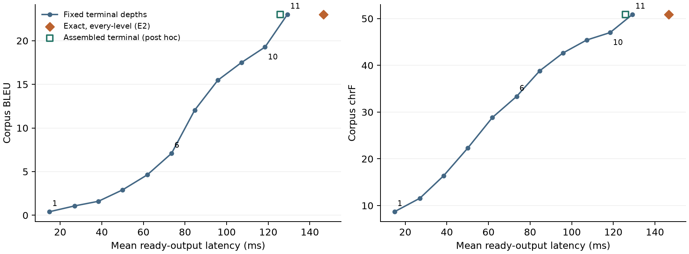
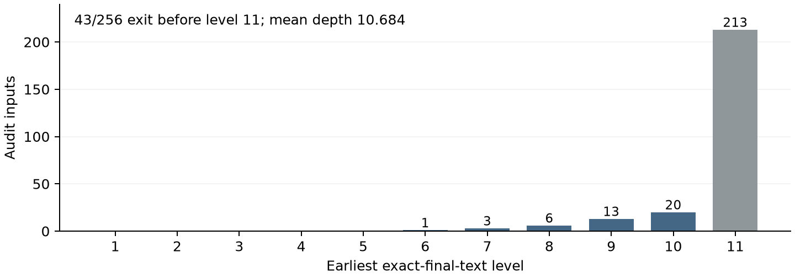

# Early answers, late exits: current evidence synthesis

**Version 4, October 24, 2026. Internal local review draft; practical adaptive speedup has not been demonstrated.**

[Eight-page PDF](paper/stronger-research-v4/main.pdf) · [Editable source and bundles](paper/stronger-research-v4/README.md) · [Claim-to-evidence map](paper/stronger-research-v4/CLAIM_EVIDENCE.md) · [Review packet](paper/stronger-research-v4/REVIEW_PACKET.md) · [Human decisions](paper/stronger-research-v4/OPEN_ITEMS.md). [Prior synthesis bytes](paper/stronger-research-v4/history/RESEARCH_SYNTHESIS-v3.md), [v3 manuscript](paper/stronger-research-v3/main.pdf) and [v2 report](RESEARCH_PAPER.md) remain preserved.

## What changed scientifically

The saved-data S1 audit found point-feasible mixed WMT exits but failed conditional quality bounds and lacked measured arbitrary-exit costs for its selected assignments. Those historical limitations remain. The new E0/E1/E2 studies measure a separate exact-text diagnostic and show that some early full-answer text exists while the tested rule lacks sufficient execution headroom.

| Evidence | Population and estimand | Result |
| --- | --- | --- |
| S1 saved assignment search | 128 reused exploration/64 reused development; finite heuristic search and assumed cost | 18/64 early development exits; surrogate 9.016% saving, conditional quality bounds fail; no certified optimum |
| E1 engineering pilot | 16 reused identities; actual forced request costs, no quality scoring | Terminal 10 saves 7.72%; every-level 10 adds 6.60% versus full |
| E2 prospective exact-only diagnostic | 256 separately assigned audit groups; actual clairvoyantly assigned execution with every-level observation charged | 43/256 early exact-final-text matches; 146.557 ms versus 129.230 ms full, 13.407% overhead; adjusted reduction interval [-15.208%,-11.310%] |
| Post-E2 terminal-cost screen | Same 256 consumed groups; post hoc assembly of existing terminal-only request cells | 125.779 ms, 2.670% savings, exploratory interval [1.735%,3.729%], below 5% even without earlier inspections; not an integrated online benchmark/global bound |

E2's exact matches are sparse and late: 1 at level 6, 3 at 7, 6 at 8, 13 at 9 and 20 at 10; 213 require 11. Mean assigned depth is 10.683594. Every fixed depth below 11 fails an adjusted corpus-quality endpoint, so its lower latency does not establish a matched-quality gain. Exact rendered equality preserves deterministic text quality relative to the same full output; it does not establish translation correctness or safety.

## Access and statistical limits

E0 sealed 256/128/1,024/571 reserved-role groups. E2 released only its 256 audit inputs; these are now consumed diagnostic/development evidence. E3's 128, E4's 1,024 and 571 unallocated per-input outcomes remain closed. Official aggregate baseline exposure, E0 source hashing, unknown document grouping and unknown checkpoint-training overlap are explicit. Neither repeats nor repeated reference reads add quality samples.

The original nonidentical-output E2 gate needed 405 covered examples under its 89-interval conservative cue method. Prospective exact-only narrowing retained 59 intervals and original quality margins; the corresponding zero-event coverage need is 385, versus only 48 actual numeric-covered E2 inputs. This is a method/sample limitation, not proof that useful approximate translations do not exist. The terminal screen is labeled post hoc and exploratory; it cannot upgrade E2's failed gate or make consumed data fresh confirmation.

No new continuation-value estimator was fitted. Current-validity classification and saved eventual-failure forecasts remain distinct from expected incremental utility. Full-resolution reconstruction, parity, causal history and real skipped-work checks support the implementation, not a universal model claim. Same-assistant arithmetic is not independent human scientific review.

## Decisions and closure

- **Completed:** original Phase 0--5; S0/S1/S2A and local S5 work; E0/E1/E2; post hoc terminal-cost budget screen; M0 archival discrepancy review; P1 local manuscript/review packet.
- **Blocked and unexecuted:** S3/E3 controller development and E4 confirmation. Neither exact diagnostic passes the required practical headroom gate.
- **Deferred and unexecuted:** S2B/M1 target encoding and S4 intervention. No actionable causal contrast or training allocation justifies these branches now.
- **Human-dependent:** verified authors/affiliations/responsibility, rights/license decisions, independent scientific review and any concrete publication authorization. No contact/upload/submission occurred.

The [M0 metadata review](results/evidence_gaps/m0/summary.md) confirms local hard-Sudoku 1,725/2,000=86.25% and rejects rounding alone as an explanation for the paper's 86.1%. Cause remains unresolved; no rerun or historical-score correction was performed. Approximate-output headroom, alternative schedules, optimal assignments, causal signals and mechanisms remain research unknowns rather than promised completed tasks.

The recommended next decision is independent human review of this bounded negative contribution. A future empirical cycle needs a distinct question and prospective eligibility/statistical/resource design, not more samples, looser margins or controller training merely to seek a positive result.

## Reproduction and verification

[E2 protocol/results](results/evidence_gaps/e2/summary.md), [terminal-screen protocol/results](results/evidence_gaps/e2_terminal_screen/summary.md), [P1 preservation/visual checks](results/evidence_gaps/p1/summary.md), [original source-linked related work](docs/studies/stronger-research-related-work.md). Exact source archives preserve executed bytes across Git newline normalization. Large datasets/weights and raw final outputs are excluded from the local review ZIPs; required assets and rights remain explicit.

Historical 451 whole-suite passes, E2's 96 focused tests and the terminal screen's 32 focused tests are separate records; no new full-suite claim is made here. The eight-page final PDF was compiled and visually inspected, while ledger/corpus/cue/timing checks retain their stated limits. Substantial AI assistance is disclosed; humans must verify and assume responsibility for any eventual scientific submission.
