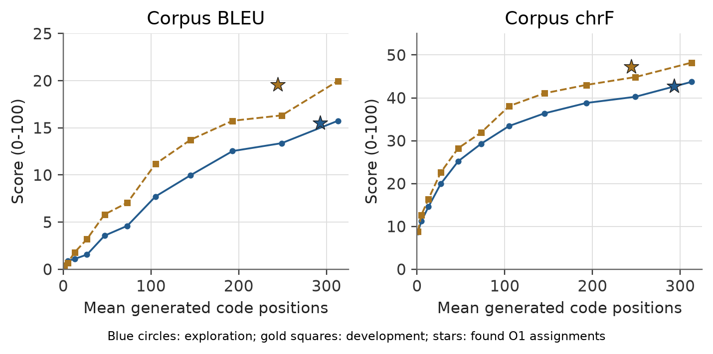
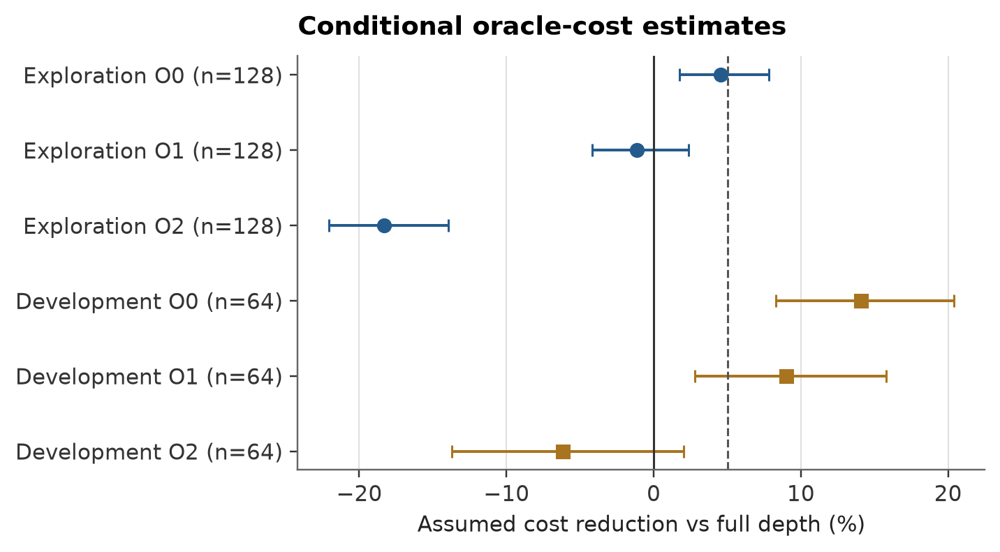
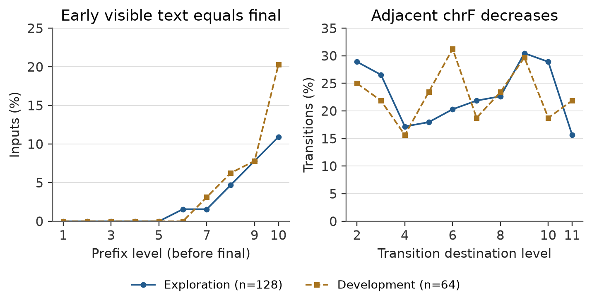

# Early-output availability and stopping costs in frozen NCM

**Research synthesis v3 - October 24, 2026. Internal draft; not peer reviewed or ready for submission.**

[Compiled manuscript](paper/stronger-research-v3/main.pdf) · [Editable LaTeX](paper/stronger-research-v3/main.tex) · [Reproducibility and remaining issues](paper/stronger-research-v3/README.md) · [Historical v2 report](RESEARCH_PAPER.md)

## Result and scientific boundary

The stronger-research cycle finds **point-feasible mixed exits in saved WMT data**, but does **not establish practical adaptive speedup**. The result distinguishes early-output availability from causal recognition and economic execution. A finite heuristic search is not a global optimum, and its reused development assignments are not confirmation of a deployed policy.

Historical Sudoku audits still find no early exact valid solutions in their tested settings. Selected historical online Sudoku/WMT policies reach full depth and add overhead. The new WMT evidence shows that complete absence of early visible translations cannot explain every policy failure: before the final level, saved visible text equals the same input's final translation on **13/64 development** and **17/128 exploration** inputs. This is retrospective equality, not semantic correctness or an online stopping signal.

## Frozen study and findings

S0 fixed the population, access rules, one deterministic decreasing-coordinate search, three cost points and 10,000 complete assignments per split/point before new outcome analysis. S1 used exactly 128 exploration and 64 development trajectories; exploration source/results were pushed before development access. All six searches exhausted the cap during a sweep, totaling 60,000 charged assignments. No new candidates were added after the cap.

| Development comparison | Full / feasible fixed depth 11 | Best feasible found, primary O1 |
| --- | ---: | ---: |
| Inputs exiting before 11 | 0/64 | 18/64 |
| Mean generated levels | 11 | 9.28125 |
| Mean generated code positions | 313 | 244.34375 |
| Corpus BLEU | 19.965679 | 19.595250 |
| Corpus chrF | 48.219904 | 47.235131 |

Point losses of 0.370429 BLEU and 0.984773 chrF meet the frozen 0.5/1.0 margins. Numeric-reference F1 is unchanged over 13 covered references; negation mismatch increases 0.015625, within the 0.02 point guardrail. These literal-cue heuristics do not certify factuality or safety.

The primary uncalibrated cost surrogate estimates **9.016% reduction**, conditional 95% interval **[2.799%,15.778%]**, versus full and selected fixed depth. It includes extra reconstruction/transfer and controller work. A higher-monitoring scenario estimates **6.190% overhead**. No actual early-exit latency was measured.

One-sided 95% quality lower bounds are **-1.163781 BLEU** and **-1.905485 chrF**, outside the allowed -0.5/-1.0. Conditional quality noninferiority therefore fails. The intervals keep optimized exits/comparator fixed, ignore selection uncertainty and cannot validate a causal selector. Missing WMT early-exit cost decomposition independently prevents a practical-headroom conclusion. **S1 decision: inconclusive.**

## Failure localization

S2A's prospective one-pass diagnosis covers 2,112 states /1,920 adjacent transitions. Exact visible early/final agreement is more common than full 64-ID agreement (13 versus 1 development cases), consistent with rendering/EOS filtering hiding token differences. Development has 147/640 sentence-chrF decreases while corpus scores generally rise. These decreases are reference-similarity changes, not proven semantic harm; lexical recall/cue persistence are also descriptive.

Representation/decoder dependence, generated-code errors, decoding sensitivity, weak stopping signals and measurement constraints remain competing explanations. R1B's 32 exact final target round trips with no early valid Sudoku targets narrow a question without identifying a causal mechanism. A new WMT target-encoding pilot would not resolve current cost/quality/fresh-confirmation constraints or uniquely select an intervention, so it is deferred.

## Evidence gates and remaining work

- **Completed:** S0A/S0B; S1A/S1B; S2A; S5A independent calculation checks; S5B local manuscript, figures and reproducibility candidate.
- **Unexecuted:** S2B target encoding and S4 intervention are deferred with rationale. S3 controller development is blocked by the unmet practical-headroom entry. No model work is performed merely to obtain a positive result.
- **Submission readiness incomplete:** human author names/affiliations, rights/license decision, final category/endorsement/account checks and independent human scientific review remain unconfirmed. No upload, endorsement request, external contact or submission occurred.

The original hard-Sudoku 86.25% versus published 86.1% discrepancy remains unexplained. Arbitrary-exit WMT latency, search optimality, causal stopping signals and independent fresh quality confirmation remain unresolved. A priced but unexecuted forced-exit timing proposal is in the S2A report; it is not an automatic extension of this cycle.

## Reproducibility and claim audit

[Inventory/access map](docs/studies/stronger-research-inventory.md), [primary-source related work](docs/studies/stronger-research-related-work.md), [S1 protocol](docs/studies/stronger-research-protocol.md), [S1 results](results/stronger_research/s1/summary.md), [S2A protocol](docs/studies/stronger-research-s2a-protocol.md), [diagnosis and branch decisions](results/stronger_research/s2a/summary.md), [independent checks](results/stronger_research/s5a/summary.md).

A separate implementation reproduced all ledger moves/digests/costs, fixed corpus points, accepted incumbents, conditional intervals, retained timing statistics and diagnosis counts. This is independent calculation by the same assistant, not independent researcher/hardware replication. The fresh full suite passed **451 tests** ([JUnit](results/stronger_research/s5a/tests.xml)). Original empirical artifacts/source snapshots/protocols remain intact. Historical README and v2 manuscript bytes are archived in the paper history directory.

| Claim type | Supported scope |
| --- | --- |
| Observed | Finite Sudoku absence; found point-feasible WMT assignments; early visible matches; selected-policy full-depth overhead |
| Conditional estimate | Assumed-cost reductions and fixed-assignment bootstrap intervals |
| Hypothesis | Representation/decoder/generator mechanism; usable causal recognition signal |
| Not established | Actual new speedup, global optimum, universal impossibility, causal mechanism, continuation-model benefit or safety |

Substantial AI assistance was used for code, analysis, literature synthesis and writing. Human authors must verify and assume responsibility for any submission. Human metadata, reviewer approval and redistribution rights are not inferred from a GitHub handle or upstream license. No new real-checkpoint inference, target encoding, model fit, final-input outcome or paid compute was used in this stronger-research cycle.
