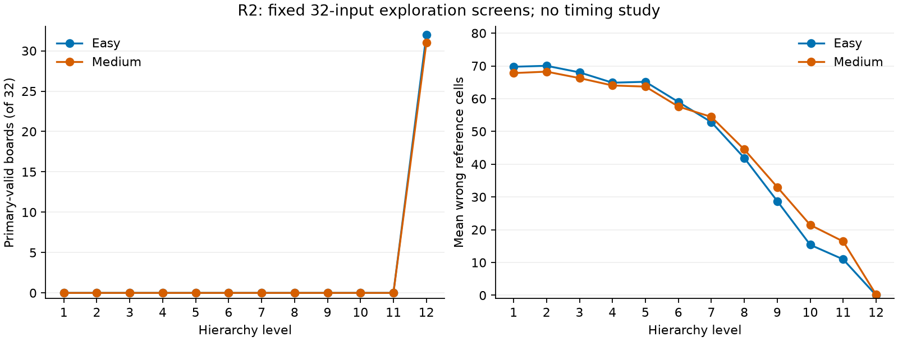

# R2: bounded easy/medium Sudoku checkpoint screen

**Completed:** October 22, 2026 (America/Toronto). Candidate order: easy, then medium only after a negative easy screen.

## Decision

**Both screens are negative at the declared budget. Close the released-Sudoku first-valid path at this budget.** Do not expand the sample, add seeds, train a controller, or proceed to Phase 2 under this result. Zero early solutions in 32 inputs per candidate is not a population impossibility claim.

The R1A/R1B diagnoses warranted testing a changed difficulty/checkpoint. No unresolved correctness failure required changing the original hard-Sudoku study. Its no-go remains unchanged.

| Candidate | Inputs | Early valid inputs | Final primary-valid | Final token/text parity | Screen decision |
| --- | ---: | ---: | ---: | ---: | --- |
| easy | 32 | 0 | 32/32 | 32/32 | negative_at_fixed_budget |
| medium | 32 | 0 | 31/32 | 32/32 | negative_at_fixed_budget |

## Per-level results

| Candidate | Level | Primary-valid / 32 | Reference matches / 32 | Official solved / 32 | Official valid grid / 32 | Official cell accuracy | Mean wrong cells | Mean wrong given | Mean wrong empty | Parseable / 32 |
| --- | ---: | ---: | ---: | ---: | ---: | ---: | ---: | ---: | ---: | ---: |
| easy | 1 | 0 | 0 | 0 | 0 | 13.89% | 69.750 | 34.344 | 35.406 | 32 |
| easy | 2 | 0 | 0 | 0 | 0 | 13.54% | 70.031 | 34.438 | 35.594 | 32 |
| easy | 3 | 0 | 0 | 0 | 0 | 16.01% | 68.031 | 33.312 | 34.719 | 32 |
| easy | 4 | 0 | 0 | 0 | 0 | 19.91% | 64.875 | 31.719 | 33.156 | 32 |
| easy | 5 | 0 | 0 | 0 | 0 | 19.56% | 65.156 | 31.969 | 33.188 | 32 |
| easy | 6 | 0 | 0 | 0 | 0 | 27.16% | 59.000 | 29.281 | 29.719 | 32 |
| easy | 7 | 0 | 0 | 0 | 0 | 34.76% | 52.844 | 26.281 | 26.562 | 32 |
| easy | 8 | 0 | 0 | 0 | 0 | 48.26% | 41.906 | 20.406 | 21.500 | 32 |
| easy | 9 | 0 | 0 | 0 | 0 | 64.51% | 28.750 | 14.281 | 14.469 | 32 |
| easy | 10 | 0 | 0 | 0 | 0 | 80.98% | 15.406 | 7.281 | 8.125 | 32 |
| easy | 11 | 0 | 0 | 0 | 0 | 86.46% | 10.969 | 5.688 | 5.281 | 32 |
| easy | 12 | 32 | 32 | 32 | 32 | 100.00% | 0.000 | 0.000 | 0.000 | 32 |
| medium | 1 | 0 | 0 | 0 | 0 | 16.28% | 67.812 | 29.656 | 38.156 | 32 |
| medium | 2 | 0 | 0 | 0 | 0 | 15.74% | 68.250 | 29.812 | 38.438 | 32 |
| medium | 3 | 0 | 0 | 0 | 0 | 18.17% | 66.281 | 28.875 | 37.406 | 32 |
| medium | 4 | 0 | 0 | 0 | 0 | 20.95% | 64.031 | 27.906 | 36.125 | 32 |
| medium | 5 | 0 | 0 | 0 | 0 | 21.37% | 63.688 | 27.875 | 35.812 | 32 |
| medium | 6 | 0 | 0 | 0 | 0 | 28.90% | 57.594 | 25.062 | 32.531 | 32 |
| medium | 7 | 0 | 0 | 0 | 0 | 32.79% | 54.438 | 23.125 | 31.312 | 32 |
| medium | 8 | 0 | 0 | 0 | 0 | 45.06% | 44.500 | 18.938 | 25.562 | 32 |
| medium | 9 | 0 | 0 | 0 | 0 | 59.22% | 33.031 | 14.406 | 18.625 | 32 |
| medium | 10 | 0 | 0 | 0 | 0 | 73.50% | 21.469 | 9.562 | 11.906 | 32 |
| medium | 11 | 0 | 0 | 0 | 0 | 79.71% | 16.438 | 6.969 | 9.469 | 32 |
| medium | 12 | 31 | 31 | 31 | 31 | 99.77% | 0.188 | 0.000 | 0.188 | 32 |

Primary acceptance requires parseability, completeness, valid rows/columns/boxes, and clue preservation. Reference agreement is a diagnostic, not an acceptance condition. Official solved/valid-grid scores retain upstream definitions, which do not independently enforce clues. Official cell accuracy uses zipped decoded characters and can overstate truncated outputs. Undefined coverage is retained; error means use parseable outputs.

## First-valid levels and every early/never-valid identity

| First valid level | easy | medium |
| --- | ---: | ---: |
| 1 | 0 | 0 |
| 2 | 0 | 0 |
| 3 | 0 | 0 |
| 4 | 0 | 0 |
| 5 | 0 | 0 |
| 6 | 0 | 0 |
| 7 | 0 | 0 |
| 8 | 0 | 0 |
| 9 | 0 | 0 |
| 10 | 0 | 0 |
| 11 | 0 | 0 |
| 12 | 32 | 31 |
| never | 0 | 1 |

**easy:** early-valid indices []; never-valid indices [].

**medium:** early-valid indices []; never-valid indices [6].

## Execution and correctness

- **easy:** 32 official comparator generations plus 32 adapter generations (64 full-depth input-evaluations); 768 generator level evaluations, 416 decoder forwards, zero encoder forwards. 32 declared upstream latent-parity and 32 independent full-prefix checks. Peak CUDA allocated memory 219.1 MiB (fit check only).
- **medium:** 32 official comparator generations plus 32 adapter generations (64 full-depth input-evaluations); 768 generator level evaluations, 416 decoder forwards, zero encoder forwards. 32 declared upstream latent-parity and 32 independent full-prefix checks. Peak CUDA allocated memory 219.1 MiB (fit check only).

Both paths use batch 1, float32/eval, deterministic released sampling, the same loaded checkpoint, and four CPU threads on the validated RTX 5060/WSL pathway. The comparator executes the unchanged pinned eval_shard prefix/pick_tokens/dec/run function bodies; CLI data loading is replaced by selective access to the fixed 32 identities. This is a matched comparator, not a new full-set official reproduction. No warmups, retries, additional seeds, timing profile, training, or target encoding occurred.

All paired final token IDs/text match exactly. Each full-resolution prefix matched independent functional embedding/convolution/interpolation arithmetic; final latents matched upstream; snapshots have independent storage and are finite. Generator/tokenizer state fingerprints match before and after. Synthetic tests preceded released-checkpoint execution. Invalid outputs remain in the raw records.

## Partitions, overlap, and limits

The easy, medium, and hard solution files are byte-identical at the pinned release. R2 inherits all 2,000 row-index partitions from the original manifest, protecting shared solutions across different clue masks. Candidate puzzle identities are incrementally hashed for all 2,000 rows, including reserved operands, without retaining those token rows/boards. Cross-partition input collisions are rejected. This identity-only traversal is disclosed separately from board/reference materialization.

Each executed candidate materializes only puzzle/reference rows 0–31, all inherited exploration. No development/final-holdout boards, reference rows, or outputs are materialized. These are related difficulty views with previously exposed exploration solutions, not independent datasets. The original full baseline previously scored reserved hard rows internally with aggregate-only access. Unknown base-model training overlap and the original unexplained +0.15-percentage-point paper reproduction discrepancy remain unresolved.

The small, fixed screen detects opportunity only. It does not identify a universal tokenizer cause, bound population absence, measure monitoring costs, or claim online speedup. No R3, online stopping, controller training, or natural-language study has started.

## Evidence and verification

[Frozen protocol](../../../docs/studies/sudoku-checkpoint-screen-protocol.md), [release inventory](../../../configs/r2_sources.json).

- **easy:** [manifest](../../../docs/partitions/sudoku-easy-r2.json), [preflight](easy/preflight.json), [attempt](easy/attempt.json), [raw paired records](easy/records.jsonl), [raw comparators](easy/comparators.jsonl), [analysis](easy/analysis.json), [board CSV](easy/board_metrics.csv), [provenance](easy/provenance.json).
- **medium:** [manifest](../../../docs/partitions/sudoku-medium-r2.json), [preflight](medium/preflight.json), [attempt](medium/attempt.json), [raw paired records](medium/records.jsonl), [raw comparators](medium/comparators.jsonl), [analysis](medium/analysis.json), [board CSV](medium/board_metrics.csv), [provenance](medium/provenance.json).

~~~powershell
python scripts/screen_sudoku_checkpoints.py --verify
~~~

Verification recomputes selection, labels, analysis, tables, candidate order, hashes and stored budgets/check declarations without torch/matplotlib imports or model calls. It does not rerun GPU latent parity. The execution budget is consumed; use saved records for report work. [Completion evidence](completion.json).
