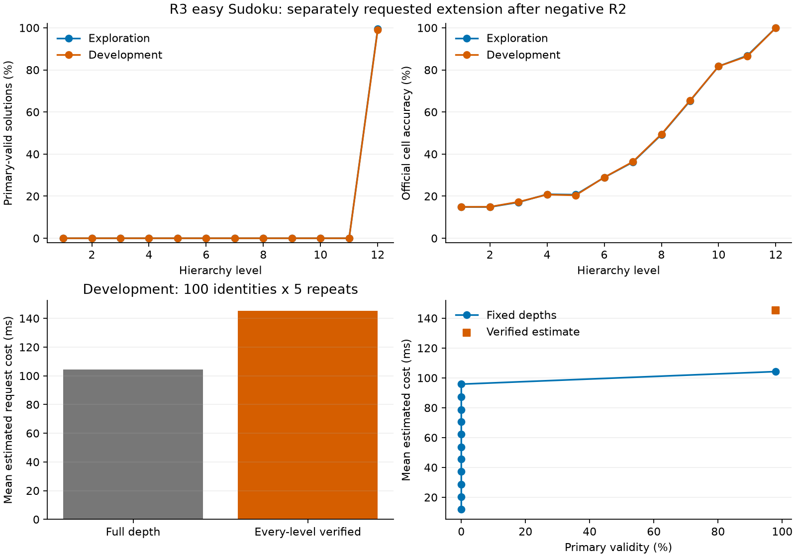

# R3 easy-Sudoku extended opportunity and cost audit

**Completed:** October 22, 2026 (America/Toronto).

**Decision: no-go.** Development estimated mean reduction -39.31%, paired 95% interval [-39.68%, -38.96%]. These are instrumented component-sum estimates, not measured online latency or speedup.

## Entry exception and scope

Neither easy nor medium qualified under R2's early-valid screen gate. The user's subsequent explicit 'Do R3' request authorized this separate extension. Easy was chosen as the first candidate in the already declared order. R2's negative result, exhausted budget and source/protocol remain unchanged; this audit does not retroactively qualify it or confirm a positive pilot.

The 32 screened easy exploration trajectories are reused within the total 1,000 exploration inputs; they are not independent confirmation examples. Another 400 development inputs complete the permitted audit. There is no medium extension, new policy search, target encoding, training, online stopping, or task change.

## Quality and opportunity

| Partition | Inputs | Early-valid inputs | Final primary-valid | Never valid |
| --- | ---: | ---: | ---: | ---: |
| exploration | 1000 | 0 | 994 | 6 |
| development | 400 | 0 | 396 | 4 |

| Partition | Level | Primary-valid | Parseable | Complete | Clue-consistent | Reference matches | Official cell accuracy |
| --- | ---: | ---: | ---: | ---: | ---: | ---: | ---: |
| exploration | 1 | 0 | 1000 | 989 | 0 | 0 | 14.84% |
| exploration | 2 | 0 | 1000 | 991 | 0 | 0 | 14.83% |
| exploration | 3 | 0 | 1000 | 991 | 0 | 0 | 17.08% |
| exploration | 4 | 0 | 1000 | 991 | 0 | 0 | 20.90% |
| exploration | 5 | 0 | 1000 | 991 | 0 | 0 | 20.70% |
| exploration | 6 | 0 | 1000 | 991 | 0 | 0 | 28.88% |
| exploration | 7 | 0 | 1000 | 991 | 0 | 0 | 36.15% |
| exploration | 8 | 0 | 1000 | 991 | 0 | 0 | 49.24% |
| exploration | 9 | 0 | 1000 | 991 | 0 | 0 | 65.23% |
| exploration | 10 | 0 | 1000 | 991 | 1 | 0 | 81.71% |
| exploration | 11 | 0 | 1000 | 991 | 3 | 0 | 86.78% |
| exploration | 12 | 994 | 1000 | 1000 | 998 | 994 | 99.98% |
| development | 1 | 0 | 400 | 397 | 0 | 0 | 14.90% |
| development | 2 | 0 | 399 | 398 | 0 | 0 | 14.94% |
| development | 3 | 0 | 399 | 398 | 0 | 0 | 17.28% |
| development | 4 | 0 | 399 | 398 | 0 | 0 | 20.73% |
| development | 5 | 0 | 399 | 398 | 0 | 0 | 20.41% |
| development | 6 | 0 | 399 | 398 | 0 | 0 | 28.93% |
| development | 7 | 0 | 399 | 398 | 0 | 0 | 36.36% |
| development | 8 | 0 | 399 | 398 | 0 | 0 | 49.44% |
| development | 9 | 0 | 399 | 398 | 0 | 0 | 65.42% |
| development | 10 | 0 | 399 | 398 | 0 | 0 | 81.71% |
| development | 11 | 0 | 399 | 398 | 0 | 0 | 86.47% |
| development | 12 | 396 | 400 | 400 | 400 | 396 | 99.94% |

Primary validity checks format, completeness, rows/columns/boxes and supplied clues. Reference equality is diagnostic only. Official cell scores use zipped decoded characters and can overstate truncated outputs; defined/undefined coverage and other official scores are retained in analysis.json.

## Estimated costs and gate

| Partition | Full mean / median / p95 (ms) | Verified mean / median / p95 (ms) | Mean reduction | Paired 95% interval |
| --- | --- | --- | ---: | --- |
| exploration | 103.512 / 102.894 / 112.237 | 144.447 / 143.523 / 154.009 | -39.55% | [-39.83%, -39.27%] |
| development | 104.224 / 102.947 / 113.190 | 145.198 / 143.646 / 155.377 | -39.31% | [-39.68%, -38.96%] |

Independent primary-label disagreements: **0**; false verifier accepts: **0**. Development collection solve-loss count: **0**. Profile-versus-collection code/output disagreements: **0/0** over all 1,000 repeats.

Estimated skipped levels/codes per development request: **0.000 / 0.000**. Profile primary validity: baseline 98.00%, verified 98.00%. Paired quality difference 0.00000, interval [0.0, 0.0].

The unchanged gate requires >=5% reduction, lower interval bound >0, zero empirical quality loss and false accepts, and passed correctness. The interval resamples 100 development identities 10,000 times (seed 20261020), retaining all five repeats per identity. The 400-input development trajectory set also checks quality preservation.

Uncorrected gate: **no-go**. Calibrated sensitivity gate: **no-go**. Sensitivity estimated reduction: -37.68%. Calibration removes median empty-region/event allowances, not all hook/launch perturbation. A gate change is inconclusive.

| Fixed depth | Mean estimated development ms | Profile validity | Full development validity |
| ---: | ---: | ---: | ---: |
| 1 | 11.867 | 0.00% | 0.00% |
| 2 | 20.322 | 0.00% | 0.00% |
| 3 | 28.722 | 0.00% | 0.00% |
| 4 | 37.153 | 0.00% | 0.00% |
| 5 | 45.600 | 0.00% | 0.00% |
| 6 | 53.711 | 0.00% | 0.00% |
| 7 | 62.164 | 0.00% | 0.00% |
| 8 | 70.622 | 0.00% | 0.00% |
| 9 | 78.787 | 0.00% | 0.00% |
| 10 | 87.333 | 0.00% | 0.00% |
| 11 | 95.808 | 0.00% | 0.00% |
| 12 | 104.224 | 98.00% | 99.00% |

Development-selected quality-feasible fixed depth: **12** (104.224 ms). This comparison is selected on development, not evaluated on a final set.

Monitoring reconstructs each prefix from scratch. Generation feedback is already in generation-stage measurements and is not charged again as monitoring. The estimate includes preparation, generation through exit, every scheduled assembly/reconstruction/decode/transfer/text/verifier/policy cost, with all checks on never-valid requests. Feature extraction is measured but excluded because this verifier-only policy does not use it. Loading, warmups, reference scoring, serialization and validation-only final parity decodes are excluded.

## Official baseline, execution and reservations

The unchanged official evaluator reports **1988/2000** solved (99.40%), cell accuracy 99.97%, valid-grid 99.40%. These rounded aggregate official metrics do not independently rescore clues. No easy-setting paper-number parity is claimed; the historical hard-Sudoku +0.15-percentage-point discrepancy remains unexplained.

All stages use the pinned easy checkpoint/config at batch 1, float32/eval on the RTX 5060/WSL pathway, with four CPU threads, deterministic official sampling, no compilation/autocast and no cache override. New evaluation allocation: 2,000 official baseline generations + 1,368 new collection generations + 1,000 timed generations + ten warmups = **4,378 generations**. Decoder forwards total **31,536**. The new collection checks all 1,368 sets of prefixes independently; profiling checks 1,000 extra final reconstruction decodes and repeated/hooked parity. Extra parity evaluations are charged to the execution budget but excluded from estimated deployed cost.

The official baseline internally reads/scores all 2,000 rows; only its printed aggregates are inspected. Its raw predictions remain local/ignored and are never opened by audit analysis. Adapter collection, profiling and analysis selectively materialize only exploration/development inputs/references. Both final partitions remain reserved for adaptive-policy work. All difficulty solution files are identical, so original row-index reservations are inherited across masks. Prior hard exploration/development exposure means difficulty views are related, not independent datasets. R2's identity-only hash traversal included reserved puzzle operands; unknown training overlap remains unresolved.

## Decision and reproduction

R3 supplies no new Phase 2 go. Retain the completed negative/inconclusive result and stop this audit at its budget. A different method/task requires a separate request and protocol.

[Frozen R3 protocol](../../../docs/studies/sudoku-easy-r3-protocol.md), [configuration](../../../configs/r3_easy.json), [analysis](analysis.json), [trajectory table](trajectory_table.csv), [completion evidence](completion.json).

[Aggregate baseline receipt](baseline_metrics.json), [baseline stage](baseline.json), [collection stage](collection.json), [trajectories](trajectories.jsonl), [prefix checks](prefix_checks.jsonl), [profile stage](profiles.json), [profile metadata](profiles/run.json), [profile components](profiles/components.jsonl), [report provenance](report_provenance.json).

~~~powershell
.\scripts\wsl_python.ps1 -PythonArguments @('scripts/finalize_sudoku_easy_r3.py','--verify')
~~~

Verification recomputes labels, partition selection, costs/bootstrap, gates, and hashes using saved permitted records, without torch/matplotlib imports or official raw prediction access. It does not rerun CUDA parity. The model-evaluation allocation is consumed; use saved evidence for report work.

## Recorded execution interruption

The first collection process stopped on a metadata filesystem-write error after 499 saved trajectories (467 new generations). The next input was reserved but had not executed. A dated [resumption amendment](../../../docs/studies/sudoku-easy-r3-resumption-amendment.md) retained all completed bytes and completed the 901 unrun inputs using the same total budget, with no repeated model evaluation. The [failed attempt](collection.failed_attempt_1.json) and [pre-resumption byte receipts](failed_collection_snapshot.json) are preserved. The interrupted process has no measured end-state fingerprint; the resumed process reloaded the exact starting state and matched it at completion. Profiling used bounded atomic metadata I/O outside timed regions.

The cost-quality figure uses the same 100 development profiling identities for both fixed-depth and verified quality. The full 400-input development validity is reported separately in the table. This report-only correction changes no outputs, measurements, analysis or decision.
