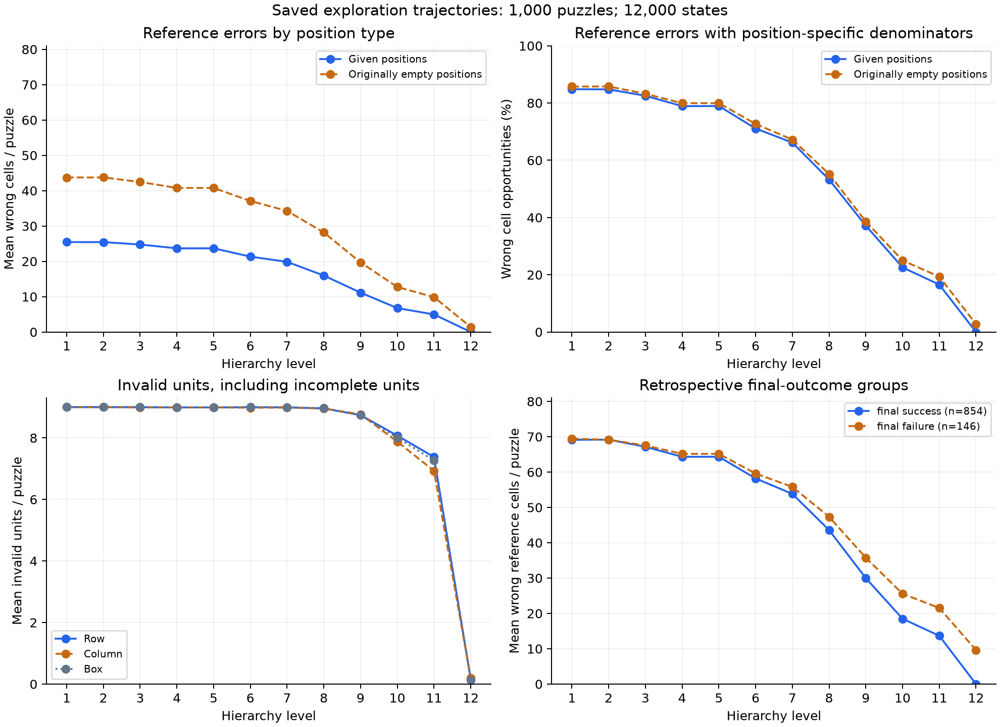
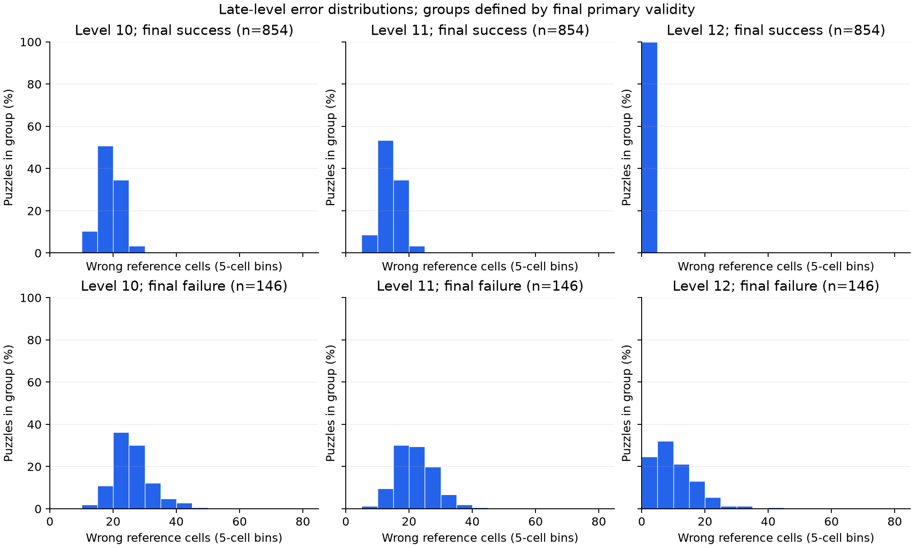
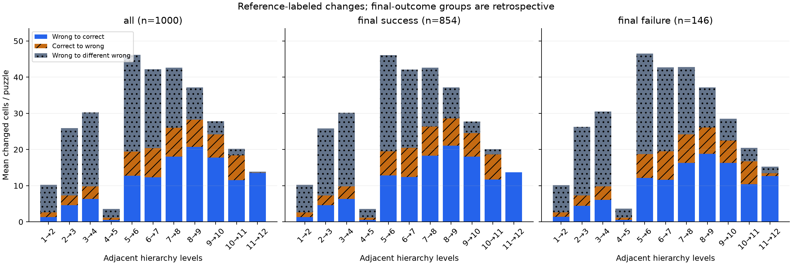

# R1A: diagnosis of saved exploration Sudoku prefixes

**Completed:** October 22, 2026 (America/Toronto). **Scope:** 1,000 exploration puzzles, 12,000 states, 11,000 adjacent transitions. No new inference or timed requests.

## Findings

- Original exploration primary counts are reproduced: zero valid outputs at levels 1–11; **854/1,000** valid at level 12. The original hard-Sudoku no-go is unchanged.
- At level 11, mean wrong reference cells are **14.821**: **4.964** at supplied clues and **9.857** at originally empty positions. **999/1,000** boards violate at least one clue.
- From level 11 to 12, mean corrected cells are **13.525**, mean correct-to-wrong cells **0.110**, and mean wrong-to-different-wrong cells **0.274**.
- At level 12, **0** boards violate clues and **0** contain blanks. **146** remain invalid; completeness or clue preservation alone is insufficient.

These are reference-labeled descriptions, not a causal explanation. The study has not encoded target solutions or changed a checkpoint. Final-outcome groups are retrospective and cannot be deployed as stopping features.

## Definitions and coverage

Wrong cells include blanks. Given and empty positions are disjoint; clue violations include blank values at given positions. Invalid units include blank or missing-digit units; duplicate metrics ignore zero. Duplicate excess is filled values minus distinct nonzero values. Row, column, box, clue, and reference-error categories overlap; their totals must not be treated as disjoint mistakes.

All 12,000 selected states are parseable; unparseable states: 0. Each level has 30,000 given-cell and 51,000 originally empty-cell opportunities, totaling 81,000 cells from 1,000 puzzles.

Level-11 wrong-cell distribution: median 14.0, p95 24.0, range 5–42. At level 12: median 0.0, p95 11.0, range 0–40. These are descriptive distributions, not confidence intervals.

Pooled given/empty error rates use total wrong cells divided by the respective summed position opportunities. All counts, exact histograms, linear-interpolation quantiles, sums, and defined/undefined coverage are retained in analysis.json.

| Level | Mean wrong cells | Mean wrong given | Mean wrong empty | Mean blanks | Boards violating clues |
| ---: | ---: | ---: | ---: | ---: | ---: |
| 1 | 69.186 | 25.452 | 43.734 | 1.053 | 1000 / 1000 |
| 2 | 69.176 | 25.430 | 43.746 | 1.053 | 1000 / 1000 |
| 3 | 67.215 | 24.762 | 42.453 | 0.234 | 1000 / 1000 |
| 4 | 64.445 | 23.675 | 40.770 | 0.234 | 1000 / 1000 |
| 5 | 64.458 | 23.685 | 40.773 | 0.234 | 1000 / 1000 |
| 6 | 58.410 | 21.330 | 37.080 | 0.228 | 1000 / 1000 |
| 7 | 54.128 | 19.854 | 34.274 | 0.207 | 1000 / 1000 |
| 8 | 44.140 | 15.977 | 28.163 | 0.149 | 1000 / 1000 |
| 9 | 30.832 | 11.142 | 19.690 | 0.095 | 1000 / 1000 |
| 10 | 19.524 | 6.772 | 12.752 | 0.065 | 1000 / 1000 |
| 11 | 14.821 | 4.964 | 9.857 | 0.039 | 999 / 1000 |
| 12 | 1.406 | 0.000 | 1.406 | 0.000 | 0 / 1000 |

| Level | Mean invalid rows / 9 | Mean invalid columns / 9 | Mean invalid boxes / 9 | Mean conflicting cells |
| ---: | ---: | ---: | ---: | ---: |
| 1 | 9.000 | 9.000 | 9.000 | 68.377 |
| 2 | 9.000 | 9.000 | 9.000 | 67.019 |
| 3 | 8.998 | 8.991 | 8.999 | 67.440 |
| 4 | 8.991 | 8.990 | 8.992 | 67.473 |
| 5 | 8.990 | 8.992 | 8.992 | 67.509 |
| 6 | 8.998 | 8.980 | 8.999 | 70.954 |
| 7 | 8.993 | 8.985 | 8.991 | 69.291 |
| 8 | 8.956 | 8.957 | 8.970 | 65.230 |
| 9 | 8.740 | 8.766 | 8.736 | 56.148 |
| 10 | 8.073 | 7.877 | 8.005 | 42.577 |
| 11 | 7.379 | 6.928 | 7.265 | 34.139 |
| 12 | 0.164 | 0.189 | 0.132 | 0.687 |

## Late levels by retrospective final outcome

| Group | Inputs | Level | Mean wrong cells | Mean wrong given | Mean wrong empty | Primary valid |
| --- | ---: | ---: | ---: | ---: | ---: | ---: |
| final_success | 854 | 10 | 18.489 | 6.823 | 11.666 | 0 |
| final_success | 854 | 11 | 13.673 | 5.006 | 8.667 | 0 |
| final_success | 854 | 12 | 0.000 | 0.000 | 0.000 | 854 |
| final_failure | 146 | 10 | 25.575 | 6.473 | 19.103 | 0 |
| final_failure | 146 | 11 | 21.534 | 4.719 | 16.815 | 0 |
| final_failure | 146 | 12 | 9.630 | 0.000 | 9.630 | 0 |

Membership is defined by final primary validity, so the final difference in primary-valid counts is tautological. This is an error-pattern comparison, not a predictive evaluation or proof of uniqueness of the supplied reference solution.

## Changes between adjacent levels

| Boundary | Mean changed | Mean corrected | Mean corrupted | Mean wrong-to-different-wrong | Puzzles with any corruption |
| --- | ---: | ---: | ---: | ---: | ---: |
| 1→2 | 10.234 | 1.329 | 1.319 | 7.586 | 740 / 1000 |
| 2→3 | 25.923 | 4.609 | 2.648 | 18.666 | 925 / 1000 |
| 3→4 | 30.201 | 6.305 | 3.535 | 20.361 | 973 / 1000 |
| 4→5 | 3.586 | 0.579 | 0.592 | 2.415 | 437 / 1000 |
| 5→6 | 46.164 | 12.725 | 6.677 | 26.762 | 997 / 1000 |
| 6→7 | 42.218 | 12.311 | 8.029 | 21.878 | 998 / 1000 |
| 7→8 | 42.631 | 18.009 | 8.021 | 16.601 | 1000 / 1000 |
| 8→9 | 37.196 | 20.758 | 7.450 | 8.988 | 1000 / 1000 |
| 9→10 | 27.843 | 17.751 | 6.443 | 3.649 | 1000 / 1000 |
| 10→11 | 20.154 | 11.548 | 6.845 | 1.761 | 1000 / 1000 |
| 11→12 | 13.909 | 13.525 | 0.110 | 0.274 | 67 / 1000 |

| Retrospective group | Boundary | Mean changed | Mean corrected | Mean corrupted | Mean wrong-to-different-wrong |
| --- | --- | ---: | ---: | ---: | ---: |
| final_success | 10→11 | 20.105 | 11.746 | 6.930 | 1.430 |
| final_success | 11→12 | 13.673 | 13.673 | 0.000 | 0.000 |
| final_failure | 10→11 | 20.438 | 10.390 | 6.349 | 3.699 |
| final_failure | 11→12 | 15.288 | 12.658 | 0.753 | 1.877 |

Changed = corrected + corrupted + wrong-to-different-wrong for every transition. Wrong-after = wrong-before − corrected + corrupted. A change can fill/create a blank as well; blank transitions overlap these categories.

## Representative examples

Choose the lowest dataset index satisfying each predeclared category; categories may share an example. Absent categories are not fabricated.

| Category | Dataset index |
| --- | ---: |
| correct_cell_corrupted | 0 |
| early_primary_success | none observed |
| final_complete_clue_consistent_grid_invalid | 6 |
| final_primary_failure | 6 |
| final_primary_success | 0 |
| level11_clue_violation_then_final_success | 0 |

### Exploration dataset index 0

Puzzle:

~~~text
.216.7.85
76....2..
..3..27..
.523.....
.........
8.67.....
2...84.36
6.81..4..
.4..9...7
~~~

Reference:

~~~text
921647385
764835291
583912764
452369178
179458623
836721549
217584936
698173452
345296817
~~~

Level 10:

~~~text
992644355
774335591
853912264
455339187
179458623
836725544
217584936
661133455
345996177
~~~

Level 11:

~~~text
921674355
764885591
553392764
455369177
179448623
836725549
217554936
661173552
355296817
~~~

Level 12:

~~~text
921647385
764835291
583912764
452369178
179458623
836721549
217584936
698173452
345296817
~~~

### Exploration dataset index 6

Puzzle:

~~~text
..58..72.
....319.6
.71...38.
.1.....65
.9.......
5...84.9.
.83..951.
....1...8
1.....67.
~~~

Reference:

~~~text
935846721
842731956
671295384
418973265
396152847
527684193
783469512
269517438
154328679
~~~

Level 10:

~~~text
395446721
442711556
679552384
491273885
399155227
526684993
783449522
629517338
154228879
~~~

Level 11:

~~~text
955846722
842731556
671552384
411277865
396155247
527684193
883449512
229517438
114328679
~~~

Level 12:

~~~text
935846721
842731956
671992384
418273865
396155247
527684193
783469512
269517438
154328679
~~~

## Reproducibility and boundaries

Selected puzzle/reference rows per file: 1000. Exploration trajectories deserialized: 1000. Development lines skipped before JSON parsing: 400. Development trajectories deserialized: 0; sealed rows materialized: 0; model calls: 0; timed requests: 0.

The source JSONL is checksummed in full, but only exploration rows are deserialized or analyzed. Original aggregate exploration counts are checked against the recorded Phase 1 analysis. All historical empirical artifacts remain unchanged.

[Analysis](analysis.json), [board metrics](board_metrics.csv), [transition metrics](transition_metrics.csv), [provenance](provenance.json).

[Pre-analysis plan](../../../docs/studies/sudoku-prefix-diagnosis-plan.md), [implementation](../../../src/anytime_ncm/diagnosis.py), [tests](../../../tests/test_diagnosis.py).

From the prepared repository:

~~~powershell
python scripts/diagnose_sudoku_prefixes.py --output results/followup/sudoku_prefix_diagnosis --verify
~~~

To reproduce into a fresh directory, run the same command without --verify in the validated WSL environment, selecting a new output path under results/followup/. Only figure generation needs Matplotlib; verification is model-free and uses the Python standard library plus existing local dataset artifacts.

## Interpretation and next action

All 1000 exploration puzzles lose at least one previously reference-correct cell at 10→11, even while aggregate reference error declines. At 11→12, 67 puzzles have such a regression; all belong to the final-failure group. Individual cell correctness is therefore not monotonically preserved by refinement.

The observed final-level recovery of all supplied clues motivates separately tracking given-position and empty-position errors in R1B target-encoded prefixes. It does not establish that an explicit clue-copy mechanism exists or that changing only the generator would fix early outputs.

The error taxonomy describes how decoded boards fail. It does not establish whether target-encoded prefixes could solve early, whether generated codes are the bottleneck, or whether another frozen checkpoint would behave differently.

Proceed next only with the separately scoped R1B protocol: encode the same preselected 32 exploration references, decode all target-code prefixes, and compare with their already saved generated prefixes. Successful target final round trips are a necessary diagnostic check; early target success would establish an early representable solution for those inputs, not prove that changing only the generator fixes all failures. If both paths fail early, retain tokenizer/decoder limitations as a hypothesis rather than an impossibility result.

Implementation preflight: the first run rejected selection metadata before trajectory analysis because the new guard expected sample_id rather than the historical puzzle_sha256 field. The guard was corrected and a regression fixture added. The successful diagnosis retained every exploration input. Report-only additions reused the same data and added no inference or timed observations.

R1A closes after this descriptive report. No R1B encoding, new checkpoint screen, online stopping, controller fitting, final-holdout evaluation, or speedup measurement occurred.
