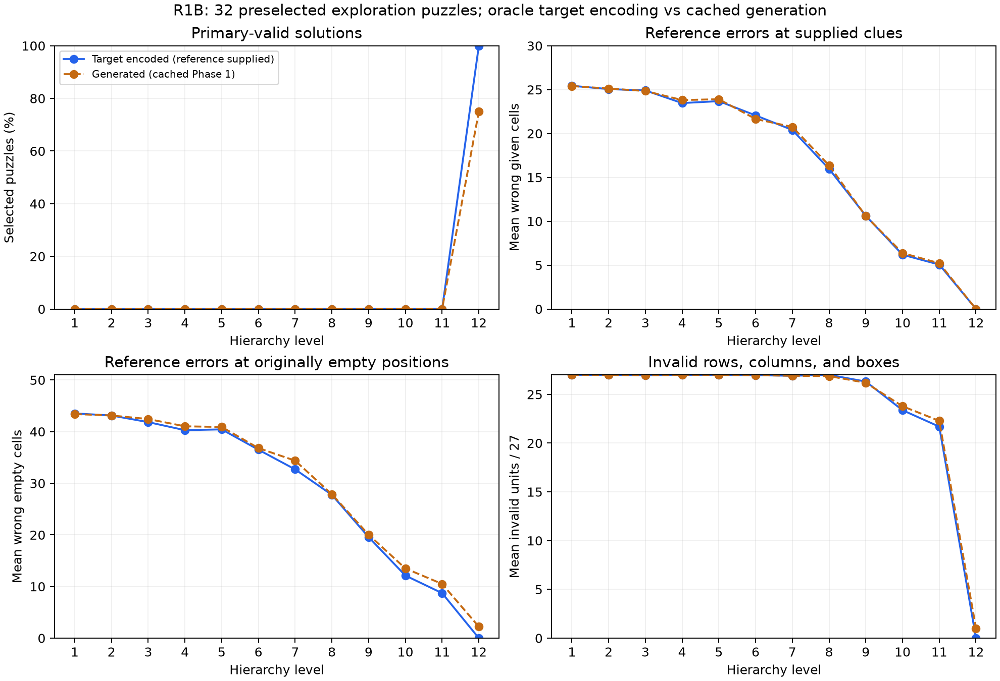

# R1B: target-encoded versus generated Sudoku prefixes

**Completed:** October 22, 2026 (America/Toronto). **Pilot:** exactly 32 preselected exploration identities, indices 0–31.

## Findings

- Target-encoded early-valid inputs (any level 1–11): **0/32**. Cached generated early-valid inputs: **0/32**.
- Final target primary-valid outputs: **32/32**; exact reference-token round trips: **32/32**; parsed-board reference matches: **32/32**.
- Final cached generated primary-valid outputs: **24/32**. These are existing outputs, not a new generation run.
- Outcome: **no_early_target_opportunity**. Recommend R2 bounded easy-then-conditional-medium checkpoint screening under its own frozen protocol.

This is a reference-based diagnostic, not an implementable stopping policy. The target path is given the solution; the generator path is not. No online latency, speedup, tokenizer training, or new Phase 2 go is established. The original hard-Sudoku no-go remains unchanged.

## Execution and checks

Exactly 32 normal upstream VQVAE.encode calls and 384 decoder forwards were used, at batch size 1, float32/eval, on the validated RTX 5060/WSL environment. In addition, 32 predeclared latent-only upstream final-reconstruction parity checks added no decoder evaluations. No warmups, generator construction/checkpoint model load, generator calls, or timing study occurred. Generator file bytes may be checksummed as part of inherited artifact integrity checks; no generator is instantiated.

The encoder includes upstream pre-quantization normalization. Deterministic nearest-code encoding is required. Cumulative prefixes retain full [1, 89, 256] resolution and independent storage. Every final latent matched upstream bitwise, and tokenizer state fingerprints matched before/after the run. Synthetic encoding, normalization, full-resolution, storage, and suffix-isolation tests precede the pilot.

These stored check declarations are traced to the source and recorded run. The model-free verifier recomputes output labels and statistics and checks integrity/budget; it does not rerun latent reconstruction or prove CUDA parity afresh.

## Per-level primary validity and secondary scores

| Level | Target valid / 32 | Generated valid / 32 | Target reference-board matches | Target official cell accuracy | Generated official cell accuracy |
| ---: | ---: | ---: | ---: | ---: | ---: |
| 1 | 0 | 0 | 0 | 14.85% | 15.05% |
| 2 | 0 | 0 | 0 | 15.82% | 15.74% |
| 3 | 0 | 0 | 0 | 17.59% | 16.94% |
| 4 | 0 | 0 | 0 | 21.30% | 19.95% |
| 5 | 0 | 0 | 0 | 20.83% | 19.98% |
| 6 | 0 | 0 | 0 | 27.70% | 27.82% |
| 7 | 0 | 0 | 0 | 34.45% | 31.94% |
| 8 | 0 | 0 | 0 | 46.03% | 45.37% |
| 9 | 0 | 0 | 0 | 62.73% | 62.19% |
| 10 | 0 | 0 | 0 | 77.39% | 75.46% |
| 11 | 0 | 0 | 0 | 82.99% | 80.59% |
| 12 | 32 | 24 | 32 | 100.00% | 97.26% |

Official cell accuracy averages per-example zipped decoded-character scores and can overstate incomplete text. Undefined scores propagate to an undefined aggregate; explicit coverage is retained in analysis.json. Primary acceptance uses parseability, completeness, valid rows/columns/boxes, and supplied clues; reference equality is separate.

The target path uses batch 1; the cached generator outputs came from the original collection in batches up to 128. This asymmetric, oracle-input comparison helps localize hypotheses but cannot by itself isolate a causal bottleneck.

## Reference/clue/constraint errors

| Path | Level | Parseable / 32 | Mean wrong reference cells | Mean wrong given | Mean wrong empty | Mean blanks | Boards violating clues |
| --- | ---: | ---: | ---: | ---: | ---: | ---: | ---: |
| target_encoded | 1 | 32 | 68.969 | 25.438 | 43.531 | 2.531 | 32 |
| target_encoded | 2 | 32 | 68.188 | 25.062 | 43.125 | 2.531 | 32 |
| target_encoded | 3 | 32 | 66.750 | 24.906 | 41.844 | 0.000 | 32 |
| target_encoded | 4 | 32 | 63.750 | 23.469 | 40.281 | 0.000 | 32 |
| target_encoded | 5 | 32 | 64.125 | 23.688 | 40.438 | 0.000 | 32 |
| target_encoded | 6 | 32 | 58.562 | 22.062 | 36.500 | 0.000 | 32 |
| target_encoded | 7 | 32 | 53.094 | 20.406 | 32.688 | 0.000 | 32 |
| target_encoded | 8 | 32 | 43.719 | 15.969 | 27.750 | 0.000 | 32 |
| target_encoded | 9 | 32 | 30.188 | 10.625 | 19.562 | 0.000 | 32 |
| target_encoded | 10 | 32 | 18.312 | 6.188 | 12.125 | 0.000 | 32 |
| target_encoded | 11 | 32 | 13.781 | 5.062 | 8.719 | 0.000 | 32 |
| target_encoded | 12 | 32 | 0.000 | 0.000 | 0.000 | 0.000 | 0 |
| generated_saved | 1 | 32 | 68.812 | 25.406 | 43.406 | 0.000 | 32 |
| generated_saved | 2 | 32 | 68.250 | 25.125 | 43.125 | 0.000 | 32 |
| generated_saved | 3 | 32 | 67.281 | 24.844 | 42.438 | 0.000 | 32 |
| generated_saved | 4 | 32 | 64.844 | 23.812 | 41.031 | 0.000 | 32 |
| generated_saved | 5 | 32 | 64.812 | 23.906 | 40.906 | 0.000 | 32 |
| generated_saved | 6 | 32 | 58.469 | 21.656 | 36.812 | 0.000 | 32 |
| generated_saved | 7 | 32 | 55.125 | 20.750 | 34.375 | 0.000 | 32 |
| generated_saved | 8 | 32 | 44.250 | 16.375 | 27.875 | 0.000 | 32 |
| generated_saved | 9 | 32 | 30.625 | 10.594 | 20.031 | 0.000 | 32 |
| generated_saved | 10 | 32 | 19.875 | 6.375 | 13.500 | 0.000 | 32 |
| generated_saved | 11 | 32 | 15.719 | 5.219 | 10.500 | 0.000 | 32 |
| generated_saved | 12 | 32 | 2.219 | 0.000 | 2.219 | 0.000 | 0 |

All per-level histograms, quantiles, row/column/box metrics, undefined coverage, paired differences, and given/empty position opportunities are in analysis.json and the 768-row board CSV. Wrong reference cells include blanks; duplicate counts ignore zero; invalid units include missing digits/blanks. These categories overlap. Rates must use each path/level's recorded parseable position denominator.

## First-valid histogram

| First valid level | Target encoded | Cached generated |
| --- | ---: | ---: |
| 1 | 0 | 0 |
| 2 | 0 | 0 |
| 3 | 0 | 0 |
| 4 | 0 | 0 |
| 5 | 0 | 0 |
| 6 | 0 | 0 |
| 7 | 0 | 0 |
| 8 | 0 | 0 |
| 9 | 0 | 0 |
| 10 | 0 | 0 |
| 11 | 0 | 0 |
| 12 | 32 | 24 |
| never | 0 | 8 |

## All final round-trip failures

- Target primary-invalid dataset indices: **[]**.
- Target parsed-board reference-mismatch indices: **[]**.
- Target decoded-token mismatch indices: **[]**.

An empty list means no observed failures in that category. Failed round trips are retained as outcomes; they are not silently removed or treated as proof of an adapter bug.

## Late adjacent-level changes

| Path | Boundary | Mean changed | Mean corrected | Mean corrupted | Mean wrong-to-different-wrong |
| --- | --- | ---: | ---: | ---: | ---: |
| target_encoded | 10→11 | 19.781 | 11.281 | 6.750 | 1.750 |
| target_encoded | 11→12 | 13.781 | 13.781 | 0.000 | 0.000 |
| generated_saved | 10→11 | 21.125 | 11.656 | 7.500 | 1.969 |
| generated_saved | 11→12 | 14.562 | 13.781 | 0.281 | 0.500 |

These future/reference-based labels are diagnostic only. Changed = corrected + corrupted + wrong-to-different-wrong; wrong-after = wrong-before − corrected + corrupted. The transition CSV retains all 352 boundaries per path (704 rows total), including undefined coverage for unparseable endpoints.

## Representative examples

Choose the lowest selected dataset index independently per predeclared category; categories may overlap. All final failures remain listed above regardless of representative selection.

| Category | Dataset index |
| --- | ---: |
| target_early_valid_generated_not_early | none observed |
| target_no_early_validity | 0 |
| target_final_primary_failure | none observed |
| target_final_token_mismatch | none observed |

### Exploration dataset index 0

Reference:

~~~text
921647385
764835291
583912764
452369178
179458623
836721549
217584936
698173452
345296817
~~~

target_levels, level 10:

~~~text
992644355|774335591|853912264|452369187|179458663|836725544|217584936|661133452|335926177
~~~

target_levels, level 11:

~~~text
921674355|774885291|883992764|455369178|179448623|836725549|217584936|661173452|355296117
~~~

target_levels, level 12:

~~~text
921647385|764835291|583912764|452369178|179458623|836721549|217584936|698173452|345296817
~~~

generated_levels, level 10:

~~~text
992644355|774335591|853912264|455339187|179458623|836725544|217584936|661133455|345996177
~~~

generated_levels, level 11:

~~~text
921674355|764885591|553392764|455369177|179448623|836725549|217554936|661173552|355296817
~~~

generated_levels, level 12:

~~~text
921647385|764835291|583912764|452369178|179458623|836721549|217584936|698173452|345296817
~~~

## Interpretation and limits

Early target validity would show that the target-encoding path can reach a useful decoded prefix for those inputs, not that a generated-code fix is sufficient. If target and generated paths both lack early valid outputs while target final round trips succeed, the tested target prefixes also fail exact validity. That supports examining tokenizer/decoder behavior as a hypothesis, not a proof that no alternative codes or decoder can work.

The sample is deliberately fixed at 32 exploration identities. It is neither a development gate nor final evaluation and supplies no population-wide absence guarantee. No solution reference or retrospective label can be supplied to an online stopping controller.

## Reproduce and verify

[Analysis](analysis.json), [raw target records](targets.jsonl), [board CSV](board_metrics.csv), [transition CSV](transition_metrics.csv), [attempt and actual forward counts](attempt.json), [provenance](provenance.json).

[Frozen R1B protocol](../../../docs/studies/sudoku-target-encoding-protocol.md), [implementation](../../../src/anytime_ncm/target_diagnostic.py), [GPU encoding contract](../../../src/anytime_ncm/target_encoding.py).

From the prepared repository, without inference:

~~~powershell
python scripts/diagnose_target_encoding.py --output results/followup/sudoku_target_encoding --verify
~~~

The original pilot budget is consumed. Do not rerun encoding merely to regenerate a report. Verification selectively loads only the 32 allowed puzzle/reference rows and cached records. Repeating released-checkpoint execution needs a separately declared allocation and fresh output directory. Report-only formatting changes can reuse saved raw targets without any model calls.

## Next action

Recommend R2 bounded easy-then-conditional-medium checkpoint screening under its own frozen protocol.

End R1B here. No R2 screen, checkpoint intervention, online stopping, controller training, or holdout evaluation was started.
