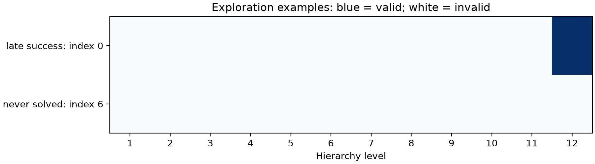

# Phase 1 trajectory audit and decision

**Completed:** October 20, 2026 (America/Toronto).

**Quality reporting completed on review:** October 21, 2026; existing trajectories and profiles reused.

**Decision: NO-GO.** This is an offline estimated-cost decision; no online speedup was measured.

No clue-consistent valid solution appeared before level 12 on any of the 1,400 inputs. The no-go reflects zero observed early-exit opportunity; correctness checks passed. It applies to this frozen Sudoku checkpoint and reconstruction/sampling setting.

## Development gate

Mean estimated reduction versus full depth: **-44.18%**, paired 95% interval **[-45.02%, -43.45%]**.
The frozen worthwhile threshold is 5%; maximum empirical quality loss and false verifier accepts are zero. Independent false accepts: **0**; validity disagreements: **0**.
Profiled development solve-rate difference (verified minus full depth): **0.00 percentage points**, 95% interval [0.00, 0.00].
Calibration sensitivity gate: **no-go**; primary diagnostic gate: **no-go**.

The gate uses the first 100 development identities at batch size 1, five repeats each. Exploration profiling is descriptive corroboration. Bootstrap: 10,000 paired puzzle-identity resamples, seed 20261020; all five repeats are retained within each cluster.

## Trajectory quality

| Partition | Inputs | Final valid | Ever valid | Never valid | Inputs with valid-to-invalid transitions |
| --- | ---: | ---: | ---: | ---: | ---: |
| exploration | 1000 | 854 (85.40%) | 854 | 146 (14.60%) | 0 |
| development | 400 | 349 (87.25%) | 349 | 51 (12.75%) | 0 |

| Level | Exploration valid / 1000 | Development valid / 400 | Exploration first valid | Development first valid |
| ---: | ---: | ---: | ---: | ---: |
| 1 | 0 | 0 | 0 | 0 |
| 2 | 0 | 0 | 0 | 0 |
| 3 | 0 | 0 | 0 | 0 |
| 4 | 0 | 0 | 0 | 0 |
| 5 | 0 | 0 | 0 | 0 |
| 6 | 0 | 0 | 0 | 0 |
| 7 | 0 | 0 | 0 | 0 |
| 8 | 0 | 0 | 0 | 0 |
| 9 | 0 | 0 | 0 | 0 |
| 10 | 0 | 0 | 0 | 0 |
| 11 | 0 | 0 | 0 | 0 |
| 12 | 854 | 349 | 854 | 349 |

### Parsing, completeness, and upstream comparison

Counts below use every input in the named partition at each level. Unparseable and parseable-but-incomplete outputs are disjoint; complete + parseable incomplete + unparseable equals the input count. Grid validity alone does not establish clue preservation.

Official solved compares decoded text exactly; reference agreement compares parsed boards. Official cell accuracy is the unweighted mean of per-example zipped-character accuracy, so truncated text can score highly. Undefined per-example accuracy is saved as null; if any value is undefined, the aggregate is also undefined rather than silently dropping it. Defined coverage is shown explicitly. These secondary metrics do not control valid-solution acceptance.

#### exploration (n=1000)

| Level | Unparseable | Parseable incomplete | Complete | Grid valid | Clue consistent | Reference agreement |
| ---: | ---: | ---: | ---: | ---: | ---: | ---: |
| 1 | 0 | 13 | 987 | 0 | 0 | 0 |
| 2 | 0 | 13 | 987 | 0 | 0 | 0 |
| 3 | 0 | 4 | 996 | 0 | 0 | 0 |
| 4 | 0 | 4 | 996 | 0 | 0 | 0 |
| 5 | 0 | 4 | 996 | 0 | 0 | 0 |
| 6 | 0 | 4 | 996 | 0 | 0 | 0 |
| 7 | 0 | 4 | 996 | 0 | 0 | 0 |
| 8 | 0 | 4 | 996 | 0 | 0 | 0 |
| 9 | 0 | 4 | 996 | 0 | 0 | 0 |
| 10 | 0 | 4 | 996 | 0 | 0 | 0 |
| 11 | 0 | 4 | 996 | 0 | 1 | 0 |
| 12 | 0 | 0 | 1000 | 854 | 1000 | 854 |

| Level | Official solved | Official valid grid | Official mean cell accuracy | Defined cell scores |
| ---: | ---: | ---: | ---: | ---: |
| 1 | 0 | 0 | 14.59% | 1000 / 1000 |
| 2 | 0 | 0 | 14.60% | 1000 / 1000 |
| 3 | 0 | 0 | 17.02% | 1000 / 1000 |
| 4 | 0 | 0 | 20.44% | 1000 / 1000 |
| 5 | 0 | 0 | 20.42% | 1000 / 1000 |
| 6 | 0 | 0 | 27.89% | 1000 / 1000 |
| 7 | 0 | 0 | 33.18% | 1000 / 1000 |
| 8 | 0 | 0 | 45.51% | 1000 / 1000 |
| 9 | 0 | 0 | 61.94% | 1000 / 1000 |
| 10 | 0 | 0 | 75.90% | 1000 / 1000 |
| 11 | 0 | 0 | 81.70% | 1000 / 1000 |
| 12 | 854 | 854 | 98.26% | 1000 / 1000 |

#### development (n=400)

| Level | Unparseable | Parseable incomplete | Complete | Grid valid | Clue consistent | Reference agreement |
| ---: | ---: | ---: | ---: | ---: | ---: | ---: |
| 1 | 0 | 3 | 397 | 0 | 0 | 0 |
| 2 | 0 | 3 | 397 | 0 | 0 | 0 |
| 3 | 0 | 2 | 398 | 0 | 0 | 0 |
| 4 | 0 | 2 | 398 | 0 | 0 | 0 |
| 5 | 0 | 2 | 398 | 0 | 0 | 0 |
| 6 | 0 | 2 | 398 | 0 | 0 | 0 |
| 7 | 0 | 2 | 398 | 0 | 0 | 0 |
| 8 | 0 | 2 | 398 | 0 | 0 | 0 |
| 9 | 0 | 2 | 398 | 0 | 0 | 0 |
| 10 | 0 | 2 | 398 | 0 | 0 | 0 |
| 11 | 0 | 2 | 398 | 0 | 0 | 0 |
| 12 | 0 | 1 | 399 | 349 | 400 | 349 |

| Level | Official solved | Official valid grid | Official mean cell accuracy | Defined cell scores |
| ---: | ---: | ---: | ---: | ---: |
| 1 | 0 | 0 | 14.89% | 400 / 400 |
| 2 | 0 | 0 | 14.79% | 400 / 400 |
| 3 | 0 | 0 | 16.99% | 400 / 400 |
| 4 | 0 | 0 | 20.07% | 400 / 400 |
| 5 | 0 | 0 | 20.14% | 400 / 400 |
| 6 | 0 | 0 | 27.83% | 400 / 400 |
| 7 | 0 | 0 | 33.23% | 400 / 400 |
| 8 | 0 | 0 | 45.30% | 400 / 400 |
| 9 | 0 | 0 | 62.19% | 400 / 400 |
| 10 | 0 | 0 | 76.09% | 400 / 400 |
| 11 | 0 | 0 | 82.09% | 400 / 400 |
| 12 | 349 | 349 | 98.51% | 400 / 400 |

Valid-to-invalid transition counts at boundaries 1→2 through 11→12: exploration [0, 0, 0, 0, 0, 0, 0, 0, 0, 0, 0]; development [0, 0, 0, 0, 0, 0, 0, 0, 0, 0, 0].

## Estimated cost and skipped code work

| Partition | Full mean / median / p95 (ms) | Verified mean / median / p95 (ms) | Mean levels skipped | Mean code positions skipped | Mean estimated reduction |
| --- | ---: | ---: | ---: | ---: | ---: |
| exploration | 156.770 / 151.624 / 202.843 | 225.245 / 218.649 / 290.545 | 0.000 | 0.000 / 322 | -43.68% |
| development | 151.021 / 146.544 / 194.359 | 217.735 / 211.705 / 276.096 | 0.000 | 0.000 / 322 | -44.18% |

These are component sums: input preparation, generation through exit, and every assembly/reconstruction/decode/transfer/text/verifier/decision check through exit. Never-valid inputs pay full generation and all 12 checks. Full depth pays one final reconstruction/decode/transfer/text output. Feature extraction is profiled separately and excluded from the verifier-only candidate, which does not use it.

Generation uses CUDA markers with no internal synchronization. Feedback reconstruction is charged to the next generation stage that needs it; standalone monitoring reconstruction is separate. Final generated-code concatenation is reused at level 12; earlier checks include prefix assembly. Full-generation host residual is charged once at every exit.

## Fixed-depth comparison

| Depth | Development valid rate: batch-128 collection | Development valid rate: batch-1 profile | Mean estimated cost (ms) |
| ---: | ---: | ---: | ---: |
| 1 | 0.00% | 0.00% | 22.078 |
| 2 | 0.00% | 0.00% | 34.094 |
| 3 | 0.00% | 0.00% | 45.917 |
| 4 | 0.00% | 0.00% | 57.599 |
| 5 | 0.00% | 0.00% | 69.313 |
| 6 | 0.00% | 0.00% | 80.689 |
| 7 | 0.00% | 0.00% | 92.552 |
| 8 | 0.00% | 0.00% | 104.693 |
| 9 | 0.00% | 0.00% | 116.179 |
| 10 | 0.00% | 0.00% | 127.946 |
| 11 | 0.00% | 0.00% | 139.718 |
| 12 | 87.25% | 86.00% | 151.021 |

Minimum-cost fixed depth with no empirical quality loss in both development views: **12**, estimated **151.021 ms**. Selection uses development data; this is not held-out performance.

## Representative exploration trajectories

Use the lowest dataset index meeting each category. Late recovery requires valid→invalid→valid; late success means first valid at level 12.

| Category | Dataset index | Valid at levels 1–12 |
| --- | ---: | --- |
| early success | none observed | — |
| late recovery | none observed | — |
| late success | 0 | · · · · · · · · · · · V |
| never solved | 6 | · · · · · · · · · · · · |

## Coverage and limitations

- Descriptive coverage: 1,000 exploration + 400 development inputs; 16,800 level records. Diagnostic coverage: first 100 identities per partition, ten exploration-only warmups, exactly five repeats per identity; 1,000 timed requests and 12,000 profiled levels. Both final holdouts remain reserved.
- Hook versus uninstrumented warmup code parity: 50 comparisons. Repeat-code parity: 800. Final reconstruction matched upstream: 1000 requests.
- WSL2/Python 3.12.3/Torch 2.10.0+cu128/RTX 5060, float32/no autocast, greedy generation, four CPU threads, no compile/KV cache. Profiling overrides baseline batch size 128 with batch size 1. Differences across the 200 profiled identities: {'final_token_different_identities': 0, 'any_level_token_different_identities': 5, 'final_validity_different_identities': 0}. The gate uses its own matched batch-one outputs.
- Empty-region calibration medians: CUDA-region wall 0.057171 ms; 13-marker trace 0.203161 ms; host region 0.000120 ms. Sensitivity subtracts these allowances with zero floors. These are not a bound on all hook/launch effects; isolated diagnostic synchronization may differ from deployed behavior.
- Zero headline online latency measurements. Loading, warmup, reference scoring, serialization, and report generation are excluded from estimates. No actual halting, batch compaction, controller training, or final-holdout evaluation occurred.
- Original full-set reproduction remains 1,725/2,000 (86.25%) versus paper 86.1%; the +0.15 percentage-point discrepancy is unexplained. Base-model training overlap is unknown.
- No Phase 1D inference failure or discarded timed request occurred in this completed run. Original trajectory timings remain null; diagnostic profiles are separate artifacts.

## Reproduction and sources

Run scripts/profile_phase1.py in the validated WSL environment, then scripts/report_phase1.py. Preserve recorded directories and use fresh output paths for repeats. [Detailed commands and boundaries](../../docs/phase1d_profiling.md).

[Trajectory table](trajectory_table.csv), [analysis](analysis.json), [profile metadata](profiles/run.json), [raw repeats](profiles/components.jsonl), [provenance](report_provenance.json), [frozen protocol](../../docs/experiment_protocol.md), [analysis plan](../../docs/phase1d_analysis_plan.md).

## Next action

Close Phase 1 with this documented no-go. Do not start online stopping or controller work under this work order. Distinguish limited estimated opportunity from any recorded correctness blocker; later studies remain on the roadmap.

## Diagnostic component breakdown

| Component | Exploration mean (ms) | Development mean (ms) |
| --- | ---: | ---: |
| input_prepare | 0.329925 | 0.324738 |
| generation_full | 147.605609 | 142.252407 |
| prefix_assembly | 2.462380 | 2.348959 |
| reconstruction | 49.301568 | 48.003199 |
| decode_select | 19.397061 | 18.792412 |
| transfer_ms | 1.677797 | 1.610013 |
| text_ms | 0.456631 | 0.446151 |
| verifier_ms | 3.996829 | 3.941002 |
| features_ms | 0.272450 | 0.263941 |
| policy_ms | 0.017080 | 0.016385 |

Generation and input preparation are once per request; monitoring components are sums over all 12 levels (assembly only 1-11). Feature cost is measured but unused by the verified candidate.
