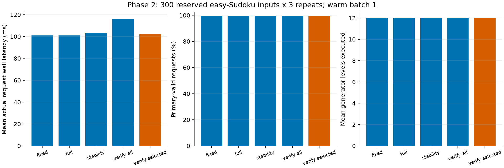

# Phase 2: actual online verified stopping

**Completed:** October 22, 2026 (America/Toronto).

**Primary claim gate: no-go.** Development-selected policy: **verified_selected**, schedule [12]. Actual mean wall-latency reduction versus full depth **-0.85%**, paired 95% interval **[-1.34%, -0.39%]**. No component sums are used as online latency.

## Entry and completed work

The original hard Phase 1 no-go, negative R2 screens and easy R3 no-go remain unchanged. The user's explicit request to unblock and finish Phase 2 authorized a separately frozen online engineering/measurement experiment despite the unmet opportunity gate. This is not a retrospective offline go. No checkpoint training, quality relaxation, task change, or Phase 3 final access occurred.

2A adds an isolated completed-level callback/limit to the actual pinned generate body. The upstream checkout remains unchanged; a unified patch and exact base/source receipts are saved. Synthetic tests and 192 real requests over 32 exploration identities establish disabled code/token/text parity, actual one/six-level forced work, causal observation isolation, offline/online exit-output equivalence and final fallback.

2B reuses saved development trajectories to select a strong quality-feasible fixed depth and a stability baseline. It benchmarks four verifier schedules, full depth, fixed depth and stability on 100 development identities x three repeats, after ten exploration warmups per method. The policy lock was committed/pushed before final access. 2C evaluates the frozen methods together on the reserved 300 Phase 2 final identities.

## Final measured comparison

| Method | Valid inputs / 300 | Early requests | False early accepts | Wall mean / median / p95 ms | Mean CUDA event elapsed ms | Peak allocated MiB | Mean levels / inspections | Serial warm requests/s |
| --- | ---: | ---: | ---: | --- | ---: | ---: | --- | ---: |
| fixed | 299 | 0 | 0 | 100.921 / 100.394 / 110.750 | 103.799 | 221.28 | 12.000 / 0.000 | 9.909 |
| full | 299 | 0 | 0 | 100.978 / 100.563 / 111.442 | 103.831 | 221.28 | 12.000 / 0.000 | 9.903 |
| stability | 299 | 0 | 0 | 103.482 / 102.956 / 114.539 | 106.386 | 221.17 | 12.000 / 3.000 | 9.664 |
| verified_all | 299 | 0 | 0 | 116.033 / 115.669 / 128.629 | 119.307 | 221.02 | 12.000 / 12.000 | 8.618 |
| verified_selected | 299 | 0 | 0 | 101.836 / 101.205 / 112.780 | 104.715 | 221.28 | 12.000 / 1.000 | 9.820 |

Each method has three repeats per input. Valid-input counts use deterministic, repeat-consistent outputs. Early requests count all repeats. Final invalid fallback outputs are model failures, not false early accepts. Independent units/clues validation is recomputed outside request timing. References never enter the online policy.

| Method | Mean reduction vs full | Paired 95% interval | Quality difference | Quality 95% interval | Gate |
| --- | ---: | --- | ---: | --- | --- |
| fixed | 0.06% | [-0.40%, 0.53%] | 0.00000 | [0.0, 0.0] | no-go |
| full | 0.00% | [0.00%, 0.00%] | 0.00000 | [0.0, 0.0] | no-go |
| stability | -2.48% | [-2.95%, -2.01%] | 0.00000 | [0.0, 0.0] | no-go |
| verified_all | -14.91% | [-15.47%, -14.38%] | 0.00000 | [0.0, 0.0] | no-go |
| verified_selected | -0.85% | [-1.34%, -0.39%] | 0.00000 | [0.0, 0.0] | no-go |

| Method | Reference matches / 300 | Official solved / 300 | Official valid grids / 300 | Official cell accuracy |
| --- | ---: | ---: | ---: | ---: |
| fixed | 299 | 299 | 299 | 99.97% |
| full | 299 | 299 | 299 | 99.97% |
| stability | 299 | 299 | 299 | 99.97% |
| verified_all | 299 | 299 | 299 | 99.97% |
| verified_selected | 299 | 299 | 299 | 99.97% |

Secondary official metrics use the pinned decoded-text definitions and do not replace clue-consistent primary validity. Cell accuracy uses zipped decoded characters; undefined coverage is retained in analysis.

Primary-versus-selected-fixed reduction: -0.91%, interval [-1.42, -0.4]; gate **no-go**. Adaptive frontier claim: **False**.

The unchanged claim rule requires >=5% mean wall reduction, lower interval bound >0, zero empirical solve-rate loss, zero false early accepts, and passed parity/correctness. Intervals use 10,000 paired identity resamples, seed 20261022, retaining all three repeats. Finite-sample zero errors are not a population guarantee.

## Development choices and bounded unblocking

Selected strong fixed depth: **12**. Selected verifier candidate: **verified_12**, using actual mean development latency with zero observed quality loss/false early accepts. Candidates were schedules 1–12, 6–12, 10–12 and 12 only. A level-12-only schedule is a degenerate checking baseline with no possible generation savings; it is not adaptive headroom.

Stability spec: {'depth': 12, 'kind': 'stability', 'levels': [10, 11, 12], 'min_level': 10, 'patience': 1}. It was selected from minimum levels {2,6,10} and unchanged-transition patience {1,2}, using all 400 development trajectories, zero invalid early exits/solve loss, and fewest decoded inspections. This uses current/past decoded IDs only. Decoder-logit uncertainty was absent from the saved study, so an unvalidated entropy baseline was not added. The retrospective first-valid oracle stays an analysis-only comparison.

Incremental monitoring lazily adds each available codebook's full-resolution learned/residual contribution once, rather than recomputing all past contributions at every check. Deferred schedules avoid intermediate decoder/verifier work. These optimizations preserve exact output and sampling; the measurements determine whether they help. They cannot create an early valid decoded board.

| Development method | Mean wall ms | Primary-valid rate | False early accepts |
| --- | ---: | ---: | ---: |
| fixed | 100.875 | 98.00% | 0 |
| full | 101.420 | 98.00% | 0 |
| stability | 104.161 | 98.00% | 0 |
| verified_10 | 104.560 | 98.00% | 0 |
| verified_12 | 101.688 | 98.00% | 0 |
| verified_6 | 109.858 | 98.00% | 0 |
| verified_all | 115.406 | 98.00% | 0 |

## Timing, resource and access limits

All methods use the same float32/eval checkpoint, batch 1, four CPU threads and deterministic official sampling on the RTX 5060/WSL pathway, without compilation/autocast/KV caching. Method order rotates by identity and repeat to balance order effects. Host wall timing synchronizes before/after the ready output and includes input preparation, generation, incremental reconstruction, decoding, transfers, text, features, verifier and policy work actually used. There is no diagnostic internal synchronization. Model loading, warmup, offline references, code diagnostics transfer and serialization are excluded consistently.

CUDA event elapsed is stream elapsed including host-driven gaps, not kernel-busy time. Two timing events and non-mutating level/decoder counters are included consistently. Peak allocated bytes are not total device memory. Serial warm requests/s is reciprocal mean timed request latency, not a batched-throughput or whole-process claim.

Final active methods: 5; final timed requests: 4500; exploration-only final warmups: 50. Aliases: {}. The total phase has hard caps of 6,912 input-generations, 82,400 first-block level evaluations and 45,694 decoder forwards; actual stage counts are retained in analysis/receipts. Failed attempts must be retained; no silent model-evaluation retry or input replacement is allowed.

The original Phase 2 identity reservation is used across difficulty masks because released solution files are byte-identical. Official full baselines previously scored these rows internally with aggregate-only analyst inspection. Policies and statistics were frozen before per-input Phase 2 final token/output access; this is a held-out policy-evaluation subset of the released test data, not a claim of zero prior aggregate exposure or known absence of base-model contamination. The 300 aligned Phase 3 final rows remain unavailable. The restricted scanner traverses file structure without materializing unselected token operands.

## Offline estimate versus measured monitoring

Final every-level measured overhead relative to full depth is 14.91%. R3 estimated 39.31% overhead on easy development using from-scratch monitoring and isolated component synchronizations. This Phase 2 implementation instead reuses incremental reconstruction and measures a whole ready-output request on a different cohort. Compare the sign and practical gate, not the numeric difference as a calibrated speedup or prediction error. Development selected deferred checking to reduce overhead; level-12-only checking cannot save generator work.

Input-integrity verification reuses R2's identity-only hashing of all puzzle rows, including reserved operands, without retaining those token rows/boards. The restricted inference/scoring reader materializes only the selected Phase 2 final rows and skips Phase 3 token operands. No per-input Phase 3 board, reference or prediction is inspected. Prior aggregate exposure is disclosed above.

The 2A patch emitter initially omitted Git's no-final-newline marker. A format-only finalizer retained the initial artifact and corrected the recorded diff; git apply --check passed. The tested online engine and all model outputs were unchanged, with zero added model evaluations.

## Evidence and reproduction

[Protocol](../../docs/studies/phase2-easy-online-protocol.md), [upstream patch](upstream_level_hook.patch.txt), [2A receipt](2a.json), [2B receipt](2b.json), [2C receipt](2c.json), [policy lock](policy_lock.json), [committed lock release](policy_lock_release.json), [holdout access](holdout_access.json), [analysis](analysis.json), [completion](completion.json), [report provenance](report_provenance.json).

~~~powershell
.\scripts\wsl_python.ps1 -PythonArguments @('scripts/run_phase2.py','verify')
~~~

Saved-data verification recomputes labels, selections, paired summaries/bootstrap/gates and checks work counts, frozen lock/access, source snapshots and artifact hashes without torch/matplotlib imports. It does not replay GPU parity. All model-evaluation budgets are consumed; reporting reuses saved records.

Phase 2 is complete as an online engineering/measurement experiment. A negative outcome provides no practical-speedup claim or automatic learned-controller work. Phase 3 requires a separate headroom justification and work order; its final set remains reserved.
