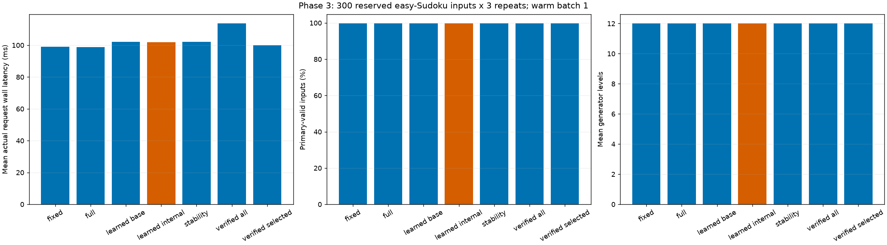

# Phase 3: learned stopping on easy Sudoku

**Completed:** October 22, 2026 (America/Toronto).

**Practical-speedup gate: no-go.** Primary: learned_internal. Mean wall reduction versus full depth -2.98%, paired 95% interval [-3.44%, -2.54%]. Strong fixed-depth gate: **no-go**. Adaptive-frontier claim: **False**.

## Work order and entry

The user explicitly requested finishing Phase 3 regardless of the negative headroom evidence. This separately frozen experiment completes that request without relabeling Phase 1/R2/R3/Phase 2 as go. No new positive early-output opportunity was assumed. No checkpoint training, task change, quality relaxation or paid compute was used.

## Training, selection and causal contract

Six standardized logistic regressions were fit on 1,000 exploration identities / 12,000 level states, using current solution validity as the sufficiency target. Positive pre-final training/development states: 0. Training positives: 994; development positives: 396. The shortage of positive early labels limits what the learner can learn; high pooled prediction quality may primarily reflect level number.

Base features are level/code counts, input clue density, decoded token histogram, change from the previous inspected output and its availability. Internal adds current codebook histogram/entropy/concentration/distinctness/adjacent changes. These are discrete code statistics, not hidden activations or logits. Neither model receives unit/clue validity flags, solutions, references, future outputs or sample identity. Input clue density is Sudoku-specific, so this is not a task-general result.

Exploration alone supplies normalization and fitting. C is selected on all 400 development trajectories by current-state log loss. Threshold/minimum selection uses the declared family and requires zero invalid early exits and no solve loss, then fewest mean inspections. Normalization never sees either final split. Fitting uses consecutive observations; the deployed tracker uses its selected inspection history. Per-schedule calibration is reported separately.

| Model | Selected C | Inspection minimum | Threshold | Development mean inspections |
| --- | ---: | ---: | ---: | ---: |
| base | 10.0 | 10 | 0.5 | 3.000 |
| internal | 0.1 | 10 | 0.5 | 3.000 |

All candidate coefficients, normalization, convergence iterations, losses, reliability bins and policy choices are retained in [training.json](training.json). Development online benchmarking adds no model/threshold candidates. Policies were committed/pushed before Phase 3 final access.

## Final measured comparison

| Method | Valid inputs | Early requests | Invalid early accepts | Wall mean / median / p95 ms | CUDA event mean ms | Peak allocated MiB | Mean levels / inspections | Serial warm requests/s |
| --- | ---: | ---: | ---: | --- | ---: | ---: | --- | ---: |
| fixed | 299/300 | 0 | 0 | 99.090 / 98.302 / 109.819 | 104.082 | 224.36 | 12.000 / 0.000 | 10.092 |
| full | 299/300 | 0 | 0 | 98.850 / 98.310 / 108.834 | 103.900 | 224.36 | 12.000 / 0.000 | 10.116 |
| learned_base | 299/300 | 0 | 0 | 102.170 / 101.160 / 112.341 | 107.407 | 224.25 | 12.000 / 3.000 | 9.788 |
| learned_internal | 299/300 | 0 | 0 | 101.800 / 101.047 / 112.608 | 107.013 | 225.56 | 12.000 / 3.000 | 9.823 |
| stability | 299/300 | 0 | 0 | 102.129 / 101.408 / 112.085 | 107.374 | 224.25 | 12.000 / 3.000 | 9.792 |
| verified_all | 299/300 | 0 | 0 | 113.614 / 113.143 / 125.368 | 119.481 | 224.10 | 12.000 / 12.000 | 8.802 |
| verified_selected | 299/300 | 0 | 0 | 100.059 / 99.338 / 110.686 | 105.167 | 224.36 | 12.000 / 1.000 | 9.994 |

| Method | Mean wall reduction vs full | Paired 95% interval | Quality difference | Quality 95% interval | Gate |
| --- | ---: | --- | ---: | --- | --- |
| fixed | -0.24% | [-0.76%, 0.25%] | 0.00000 | [0.0, 0.0] | no-go |
| full | 0.00% | [0.00%, 0.00%] | 0.00000 | [0.0, 0.0] | no-go |
| learned_base | -3.36% | [-3.97%, -2.77%] | 0.00000 | [0.0, 0.0] | no-go |
| learned_internal | -2.98% | [-3.44%, -2.54%] | 0.00000 | [0.0, 0.0] | no-go |
| stability | -3.32% | [-3.84%, -2.82%] | 0.00000 | [0.0, 0.0] | no-go |
| verified_all | -14.94% | [-15.51%, -14.38%] | 0.00000 | [0.0, 0.0] | no-go |
| verified_selected | -1.22% | [-1.68%, -0.77%] | 0.00000 | [0.0, 0.0] | no-go |

Primary versus selected fixed reduction: -2.73%; paired interval [-3.219, -2.231]. The fixed comparator was selected using development, not final outcomes.

The claim rule requires >=5% mean wall reduction, lower paired interval >0, zero empirical solve loss and zero invalid early accepts with correctness/parity passed. Both full and strong fixed comparisons must pass for a frontier claim. Statistics use 10,000 paired identity bootstrap resamples, seed 20261022, retaining all three repeats. Finite-sample zero errors do not guarantee population correctness.

## Calibration and internal-feature ablation

| Model | Inspected states (repeat 0) | Brier / cluster 95% interval | Log loss / cluster 95% interval | Mean included feature+score CPU ms/request |
| --- | ---: | --- | --- | ---: |
| learned_base | 900 | 0.001124 / [2.4254074294102268e-05, 0.003318882372505863] | 0.008443 / [0.0028036929806135634, 0.01956725076074385] | 0.1365 |
| learned_internal | 900 | 0.001442 / [0.0003654973930143059, 0.0035565074122669293] | 0.017787 / [0.013514552230808401, 0.02576472113054179] | 0.1871 |

These probabilities concern CURRENT validity at the deployed inspection levels. Repeat 0 supplies calibration states; all repeats supply latency. Reliability-bin counts, mean scores and valid rates are retained in analysis. Identity cluster resampling keeps all inspected states together. No extra final decoding was done to fill uninspected levels. Feature+score CPU timing excludes GPU reconstruction/decoding and code/token transfers; all of those are included in actual request latency.

The internal ablation compares only the stated discrete-code statistics with the stated decoded/input features. It does not test all transformer statistics, establish cross-task H3, or manufacture early-positive training labels. On matched inspected states, internal-minus-base Brier difference is 0.000318, paired identity-bootstrap 95% interval [0.000177, 0.000415]. The internal model predicts current validity less accurately on these states; no incremental predictive-value benefit is established.

## Predeclared clue-count subgroups

| Subgroup | Inputs | Full valid | Internal valid | Full mean ms | Internal mean ms |
| --- | ---: | ---: | ---: | ---: | ---: |
| clues_le_27 | 0 | 0 | 0 | unavailable | unavailable |
| clues_gt_27 | 300 | 299 | 299 | 98.850 | 101.800 |

Subgroups are descriptive and were fixed at <=27 versus >27 input clues before final access. They do not tune policies or create additional confirmatory claims.

## Execution, access and limitations

The model checkpoint/weights/buffers and upstream checkout stay unchanged. Real development requests match saved R3 exit codes/outputs and causal scores. Synthetic small-generator tests separately exercise actual learned early stops, fallback and future/reference isolation. Three repeats per final input are checked for identical outputs; labels are independently recomputed from Sudoku units and clues outside request timing.

Headline timing uses matched synchronized ready-output wall boundaries, float32/eval, batch 1 and four CPU threads on the RTX 5060/WSL pathway. It includes input preparation, generation, reconstruction, decoding, necessary transfers, learned features/scoring and policy callbacks. Loading, exploration warmups, reference scoring, diagnostic code transfer and serialization are excluded. CUDA event elapsed includes host-driven gaps and is not kernel-busy time. Peak allocated bytes are not total device memory. Requests/s is reciprocal serial warm mean latency, not batched throughput. Included counters/events and CPU submeasurement timers add instrumentation overhead.

Development: 2,100 timed requests +70 exploration warmups. Final: 6300 timed requests +70 exploration warmups. Final actual counts: {'decoder': 21840, 'encoder': 0, 'generator_levels': 76440, 'inputs': 6370}. Predeclared total caps: 8,540 input-generations / 102,480 levels / 63,440 decoder forwards / zero encodings. No model evaluation retry, extra seed, sample replacement, policy retuning or post-final calibration fit is permitted.

The inherited reserved phase3_final subset contains 300 easy-mask identities; it has now been used. Related difficulty masks share solution rows; exploration/development exposure and prior full-baseline aggregates were disclosed before access. Identity hashing traverses all reserved operands without retaining boards. The restricted inference/scoring reader opens only the selected final subset and exploration warmups; phase2_final is not used for training/selection or this evaluation. Unknown base-model overlap and shared difficulty views prevent an entirely untouched official-test claim.

Saved checkpoints cannot be altered by a stopping policy. With no useful early outputs, a learned classifier can only preserve full generation while adding monitoring cost, or risk invalid early accepts. The measured result is specific to this frozen setting, feature family, threshold grid and sample; it does not prove a population impossibility. Phase 3 is complete as a positive-or-negative experiment. No automatic Phase 4 work is authorized.

## Evidence and reproduction

[Protocol](../../docs/studies/phase3-easy-learned-protocol.md), [training](training.json), [3A receipt](3a.json), [development](development_analysis.json), [3B receipt](3b.json), [policy lock](policy_lock.json), [lock release](policy_lock_release.json), [access](holdout_access.json), [3C receipt](3c.json), [analysis](analysis.json), [completion](completion.json), [provenance](report_provenance.json).

~~~powershell
.\scripts\wsl_python.ps1 -PythonArguments @('scripts/run_phase3.py','verify')
~~~

Saved-data verification recomputes causal scores, labels, calibration, development selection, paired metrics/intervals and gates without torch/matplotlib imports. It checks execution snapshots, input/output hashes and work caps; it does not replay GPU parity. Model-work budgets are consumed; do not rerun 3a/3b/3c to reproduce a report.
