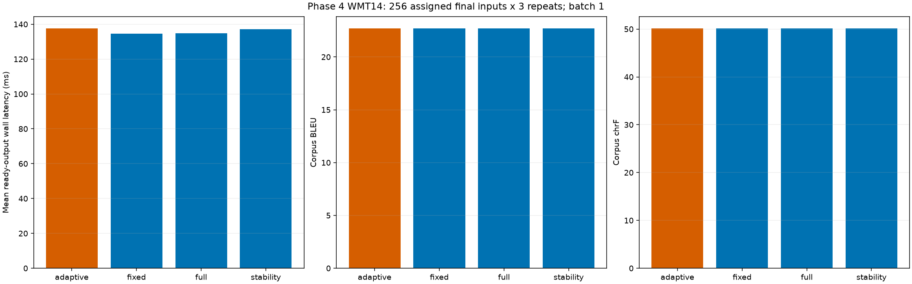

# Phase 4: WMT14 German-to-English generalization

**Completed:** October 23, 2026 (America/Toronto).

**Primary practical-speedup gate: no-go.** Strong fixed-depth gate: **no-go**. Adaptive-frontier claim: **False**.

## Scope and task-grounded baseline

This explicitly requested phase evaluates the released WMT14 De-En checkpoint, not XSum. It preserves all earlier Sudoku results and stops before Phase 5. No checkpoint/controller training, paid compute, sampling change or task-general correctness verifier was introduced.

The verbatim pinned official prefix/pick_tokens/dec/run bodies reproduce all 3003 released rows at batch 8 (release default 64, predeclared memory override). Cased BLEU **21.722**, lowercase BLEU **22.615**, chrF **49.570**. This is an operational released-checkpoint reproduction; exact paper-number or default-batch parity is not claimed. Whole baseline duration includes loading/processing and is not warm request latency.

The pre-tokenizer is pinned Qwen/Qwen3-0.6B tokenizer data only; its language-model weights were not downloaded. The NCM generator predicts 11 code levels (1,4,8,14,20,26,32,40,48,56,64), 313 code positions. The source is truncated/padded to 96 token IDs and the decoder emits 64 target IDs before official EOS truncation/special-token filtering. Learned L1 cascade upsampling, intermediate GroupNorm and residual transforms are preserved. These semantics differ from Sudoku and were independently tested.

## Frozen allocation, metrics and tolerances

All 3,003 effective padded source-prefix identities were distinct. The input-only manifest allocates 512 exploration groups, 256 development, 256 phase4_final and 1,979 reserved/unused groups. First 32 official rows belong to exploration. The offline audit uses 128 exploration and 64 development groups; the final comparison uses all 256 assigned final groups. No reference is used for partitioning. The official full baseline had prior internal final-reference scoring with aggregate-only analyst access; unknown base-model overlap remains. This is a reserved policy-evaluation subset, not an entirely untouched official test set.

Cased corpus BLEU and corpus chrF use pinned sacreBLEU defaults matching upstream. Maximum acceptable empirical losses versus full depth are **0.5 BLEU** and **1.0 chrF point** on their 0–100 scales. Final support requires paired quality lower interval bounds within both margins, >=5% mean ready-output latency reduction with lower interval >0, and disclosed heuristic guardrails. A frontier claim must also beat the strong development-selected fixed depth at matched quality. Quality/latency uncertainty is retained; an inconclusive result is not relabeled success.

Numeric reference F1 uses literal English digit-number sets only where references contain digit numbers. Negation cue mismatch uses no/not/never/neither/without/n't presence. These are heuristic diagnostics and causal transition guards, not factual/polarity truth labels. Written numbers, punctuation formats, paraphrases, not-only constructions and source/reference disagreement can produce misses or false flags. No semantic-equivalence or factual-consistency guarantee follows from BLEU/chrF or these cues.

## Offline full-resolution quality and non-monotonicity

| Level | Exploration BLEU | Exploration chrF | Development BLEU | Development chrF |
| --- | ---: | ---: | ---: | ---: |
| 1 | 0.235 | 8.743 | 0.387 | 8.846 |
| 2 | 0.883 | 11.242 | 0.672 | 12.690 |
| 3 | 1.097 | 14.577 | 1.805 | 16.401 |
| 4 | 1.554 | 19.932 | 3.192 | 22.589 |
| 5 | 3.560 | 25.222 | 5.816 | 28.263 |
| 6 | 4.609 | 29.281 | 7.053 | 31.896 |
| 7 | 7.713 | 33.438 | 11.166 | 38.075 |
| 8 | 9.968 | 36.367 | 13.729 | 41.057 |
| 9 | 12.536 | 38.804 | 15.751 | 43.020 |
| 10 | 13.375 | 40.251 | 16.321 | 44.852 |
| 11 | 15.747 | 43.735 | 19.966 | 48.220 |

| Development transition | Sentence-chrF improves | Damages | Unchanged | Mean sentence-chrF change |
| --- | ---: | ---: | ---: | ---: |
| 1 to 2 | 46 | 16 | 2 | 3.055 |
| 2 to 3 | 48 | 14 | 2 | 3.487 |
| 3 to 4 | 52 | 10 | 2 | 5.597 |
| 4 to 5 | 47 | 15 | 2 | 4.760 |
| 5 to 6 | 43 | 20 | 1 | 3.346 |
| 6 to 7 | 52 | 12 | 0 | 7.321 |
| 7 to 8 | 45 | 15 | 4 | 2.981 |
| 8 to 9 | 35 | 19 | 10 | 2.410 |
| 9 to 10 | 36 | 12 | 16 | 2.098 |
| 10 to 11 | 37 | 14 | 13 | 2.952 |

Development has 147/640 adjacent sentence-chrF deteriorations despite improving corpus quality. These are reference-metric deteriorations, not verified factual errors.

Transition direction uses sentence chrF as an offline reference-based diagnostic. It is distinct from corpus chrF/BLEU and does not become an inference feature. The retrospective best-prefix quality is an offline oracle, not a deployable policy. Full trajectories and all targeted per-level metrics are retained in the audit artifacts.

## Development policy choices

Strong fixed depth: **11**. Stability: {'epsilon': 0.0, 'kind': 'stability', 'minimum': 10, 'patience': 1}. Primary guarded stability: {'epsilon': 0.0, 'kind': 'guarded', 'minimum': 10, 'patience': 1}.

Both selected adaptive families inspect only levels 10 and 11. The first inspection cannot stop, so these are degenerate full-depth fallbacks with no possible early-generation savings, not demonstrated adaptive headroom.

All 11 fixed depths and 36 adaptive candidates are retained. Development uses point quality/heuristic margins; selection minimizes inspected decodes, then generated levels using the declared tie breaks. First observation cannot stop, and level 11 is unconditional fallback. Guarded stability additionally requires unchanged current/previous digit-number and negation cues. No reference, future output, metric, oracle label or sample identity enters online decisions. Online development timings do not expand or retune the candidate family. Selection uses the predeclared inspection-count proxy, not an exhaustive measured-latency search over all possible adaptive policies.

| Development method | Mean wall ms | BLEU | chrF | Early timed requests |
| --- | ---: | ---: | ---: | ---: |
| adaptive | 135.646 | 19.966 | 48.220 | 0 |
| fixed | 133.209 | 19.966 | 48.220 | 0 |
| full | 132.568 | 19.966 | 48.220 | 0 |
| stability | 135.652 | 19.966 | 48.220 | 0 |

## Frozen final comparison

| Method | BLEU | chrF | Wall mean / median / p95 ms | Mean levels / inspections | Early timed requests | Peak allocated MiB | Serial warm requests/s |
| --- | ---: | ---: | --- | --- | ---: | ---: | ---: |
| adaptive | 22.687 | 50.105 | 137.529 / 136.239 / 151.629 | 11.000 / 2.000 | 0 | 1139.42 | 7.271 |
| fixed | 22.687 | 50.105 | 134.656 / 133.535 / 148.493 | 11.000 / 0.000 | 0 | 1139.33 | 7.426 |
| full | 22.687 | 50.105 | 134.905 / 133.661 / 150.501 | 11.000 / 0.000 | 0 | 1139.33 | 7.413 |
| stability | 22.687 | 50.105 | 137.247 / 136.359 / 151.772 | 11.000 / 2.000 | 0 | 1142.40 | 7.286 |

| Method | Mean latency reduction vs full | Paired 95% interval | BLEU difference / 95% interval | chrF difference / 95% interval | Gate |
| --- | ---: | --- | --- | --- | --- |
| adaptive | -1.95% | [-2.49%, -1.40%] | 0.000 / [0.0, 0.0] | 0.000 / [0.0, 0.0] | no-go |
| fixed | 0.18% | [-0.28%, 0.65%] | 0.000 / [0.0, 0.0] | 0.000 / [0.0, 0.0] | no-go |
| full | 0.00% | [0.00%, 0.00%] | 0.000 / [0.0, 0.0] | 0.000 / [0.0, 0.0] | no-go |
| stability | -1.74% | [-2.20%, -1.26%] | 0.000 / [0.0, 0.0] | 0.000 / [0.0, 0.0] | no-go |

Primary versus selected fixed mean reduction: -2.13%, paired interval [-2.631, -1.628]; quality differences/intervals are retained in analysis. Gate: **no-go**.

| Method | Reference-number F1 | References with digit numbers | Negation-cue mismatch rate | Mean CUDA stream elapsed ms |
| --- | ---: | ---: | ---: | ---: |
| adaptive | 0.6949 | 45 | 0.0508 | 147.582 |
| fixed | 0.6949 | 45 | 0.0508 | 144.468 |
| full | 0.6949 | 45 | 0.0508 | 144.708 |
| stability | 0.6949 | 45 | 0.0508 | 147.261 |

## What transfers from Sudoku

This bounded WMT comparison does not establish a practical adaptive frontier advantage under the predeclared quality/cost rule. Unlike Sudoku, translation quality is graded and there is no cheap exact acceptance predicate here. The audit measures when later levels improve or damage reference-based quality, while the final experiment charges actual monitoring cost. The Sudoku absence of early exact solutions cannot be treated as a universal statement about language generation; equally, approximate metric similarity cannot establish semantic correctness or safety.

## Deterministic exploration examples

The first three exploration inputs and the largest adjacent sentence-chrF improvement/damage are chosen by the frozen rule (ties by index then level). These are diagnostics, not policy inputs. Source/reference excerpts, indices and all generated levels are saved in [examples.json](examples.json); full pinned inputs remain in the local dataset files.

**first exploration inputs; source index 0**

> Source: Gutach: Noch mehr Sicherheit für Fußgänger
> Reference: Gutach: Increased safety for pedestrians
> Level 1: Room Notes: The   the,, the,,, 
> Full depth: Gach: Even more safety for.

**first exploration inputs; source index 1**

> Source: Sie stehen keine 100 Meter voneinander entfernt: Am Dienstag ist in Gutach die neue B ...
> Reference: They are not even 100 metres apart: On Tuesday, the new B 33 pedestrian lights ...
> Level 1: The, in 1000, the in the the,
> Full depth: They are not 100 meters away from another another: On Tuesday in the new B 33 pedestrian traffic was moved into operation in the village premises - in sight of the older town hall lights.

**first exploration inputs; source index 2**

> Source: Zwei Anlagen so nah beieinander: Absicht oder Schildbürgerstreich?
> Reference: Two sets of lights so close to one another: intentional or just a silly error?
> Level 1: We you, the, and the you and the to the time.
> Full depth: There are so two so close: intention or coup d coup coup?

**largest sentence-chrF improvement; source index 363**; transition {'from': 5, 'to': 6, 'sentence_chrf_difference': 42.781799482228635}

> Source: Sprichwörter kommen aus der Bibel
> Reference: Sayings come from the Bible
> Level 1: Theuated in the European States of the..
> Full depth: Pressure come from the Bible

**largest sentence-chrF damage; source index 141**; transition {'from': 5, 'to': 6, 'sentence_chrf_difference': -20.560898142329542}

> Source: Mit Musik einen unterhaltsamen Nachmittag erlebt
> Reference: Music makes for an entertaining afternoon
> Level 1: I to the and adults, the to...
> Full depth: Experience an expensive evening with music

## Timing, provenance and limitations

All methods use the same frozen float32/eval checkpoint, pinned tokenizer, top-k1/top-p0 sampling, batch 1 and four CPU threads on RTX 5060/WSL2. Each request includes source tokenization, context transfer, generation, full-resolution reconstruction, decoding, transfers, text and actual features/policy. Request-boundary synchronization and algorithm-required transfers are included; no diagnostic per-stage synchronization is inserted. Loading, exploration warmups, offline reference scoring, diagnostic code transfer and serialization are excluded. Balanced cyclic ordering and three repeats are recorded. CUDA event elapsed includes host gaps, not kernel-busy time. Peak allocation is not total GPU memory; reciprocal serial latency is not batched throughput.

Quality intervals use 10,000 paired identity resamples (seed 20261023) with exact sacreBLEU sufficient-statistic reconstruction, checked against direct corpus scoring. All three latency repeats remain together in timing resamples. Quality uses repeat 0 after deterministic output consistency checks. This is one fixed allocation and finite checkpoint/task/sample, not multi-seed or multi-task confirmation.

The official batch-8 baseline and batch-one study are distinct; 32 matched batch-one official/disabled-hook requests establish exact codes/tokens/text parity, and all 192 audit reconstructions match independent learned-cascade arithmetic. Development requests match offline exits/prefixes. Per-stage source snapshots and model fingerprints preserve execution versions and unchanged weights/buffers. Synthetic tests separately prove actual forced generator skipping and future-code isolation.

Final actual counts: {'decoder': 4656, 'encoder': 0, 'generator_levels': 34144, 'inputs': 3104}; final timed requests 3072 plus 32 exploration warmups. Total predeclared Phase 4 caps:7,163 generations /78,793 sample-weighted generator levels /28,603 decoder forwards /zero full encoder forwards. Raw-prefix encoder embedding lookups still occur. Model evaluation failures/retries, if any, must remain recorded; budgets cannot silently expand.

The full official baseline exposed aggregates for all released test examples before policy work; training-data contamination is unknown. Only assigned final groups are opened for the frozen final comparison; remaining groups stay unavailable to study policy selection. Reusing the evaluated final subset later cannot support an untouched-test claim. Numbers/negation cues and BLEU/chrF do not provide factual-consistency guarantees. Prior Sudoku metrics, checkpoints, protocols and negative findings remain unchanged. Phase 5 has not started.

## Evidence and reproduction

[Protocol](../../../docs/studies/phase4-wmt14-protocol.md), [sources](../../../configs/phase4_wmt_sources.json), [manifest](../../../docs/partitions/wmt14-phase4.json), [preflight](preflight.json), [official baseline](official_full.json), [4A receipt](4a.json), [audit](audit_analysis.json), [4B receipt](4b.json), [development](development_analysis.json), [policy lock](policy_lock.json), [lock release](policy_lock_release.json), [access](holdout_access.json), [4C receipt](4c.json), [analysis](analysis.json), [completion](completion.json), [report provenance](report_provenance.json).

~~~powershell
.\scripts\wsl_python.ps1 -PythonArguments @('scripts/run_phase4.py','verify')
~~~

Verification recomputes selection, causal exits, quality, paired statistics, counts and hashes from saved records without torch/matplotlib imports; pinned local artifacts are still required. It does not replay model inference. The allocation is consumed; do not rerun 4a/4b/4c to reproduce a report.
